# Phân tích lỗi: overfit200_vi_ft / vi_hard_greedy

> **Lưu ý:** CER tập này (78.3%) cao gấp 48.3 lần val CER của cùng mô hình (1.6%): mô hình đã hội tụ trên phân phối huấn luyện, còn tập này khó hoặc khác phân phối.

## 1. Tổng quan

| Chỉ số | Giá trị |
|---|---|
| Số mẫu / số ký tự nhãn | 80 / 846 |
| CER | 78.25% (95% CI: 74.81-81.42%) |
| Word Accuracy (khớp hoàn toàn) | 0.00% (95% CI: 0.00-0.00%) |
| Thay thế S / Xóa D / Chèn I | 361 / 291 / 10  (42.67% / 34.40% / 1.18% số ký tự nhãn) |

Khoảng tin cậy bootstrap theo mẫu (1000 lần). CER = (S+D+I)/N gộp toàn tập.

## 2. Phân bố lỗi theo loại

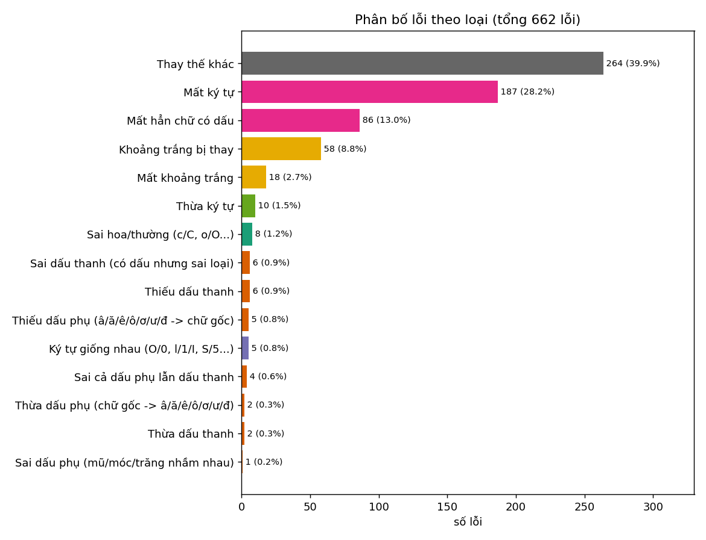

| Loại lỗi | Nhóm | Số lỗi | % tổng lỗi |
|---|---|---|---|
| Thay thế khác | Thay thế khác | 264 | 39.9 |
| Mất ký tự | Mất ký tự | 187 | 28.2 |
| Mất hẳn chữ có dấu | Mất ký tự | 86 | 13.0 |
| Khoảng trắng bị thay | Khoảng trắng | 58 | 8.8 |
| Mất khoảng trắng | Khoảng trắng | 18 | 2.7 |
| Thừa ký tự | Thừa ký tự | 10 | 1.5 |
| Sai hoa/thường (c/C, o/O...) | Hoa/thường | 8 | 1.2 |
| Thiếu dấu thanh | Lỗi dấu tiếng Việt | 6 | 0.9 |
| Sai dấu thanh (có dấu nhưng sai loại) | Lỗi dấu tiếng Việt | 6 | 0.9 |
| Ký tự giống nhau (O/0, l/1/I, S/5...) | Ký tự giống nhau | 5 | 0.8 |
| Thiếu dấu phụ (â/ă/ê/ô/ơ/ư/đ -> chữ gốc) | Lỗi dấu tiếng Việt | 5 | 0.8 |
| Sai cả dấu phụ lẫn dấu thanh | Lỗi dấu tiếng Việt | 4 | 0.6 |
| Thừa dấu thanh | Lỗi dấu tiếng Việt | 2 | 0.3 |
| Thừa dấu phụ (chữ gốc -> â/ă/ê/ô/ơ/ư/đ) | Lỗi dấu tiếng Việt | 2 | 0.3 |
| Sai dấu phụ (mũ/móc/trăng nhầm nhau) | Lỗi dấu tiếng Việt | 1 | 0.2 |

Theo nhóm lớn: Mất ký tự 273 (41.2%); Thay thế khác 264 (39.9%); Khoảng trắng 76 (11.5%); Lỗi dấu tiếng Việt 26 (3.9%); Thừa ký tự 10 (1.5%); Hoa/thường 8 (1.2%); Ký tự giống nhau 5 (0.8%)

## 3. Ma trận nhầm lẫn và top-20 cặp nhầm lẫn

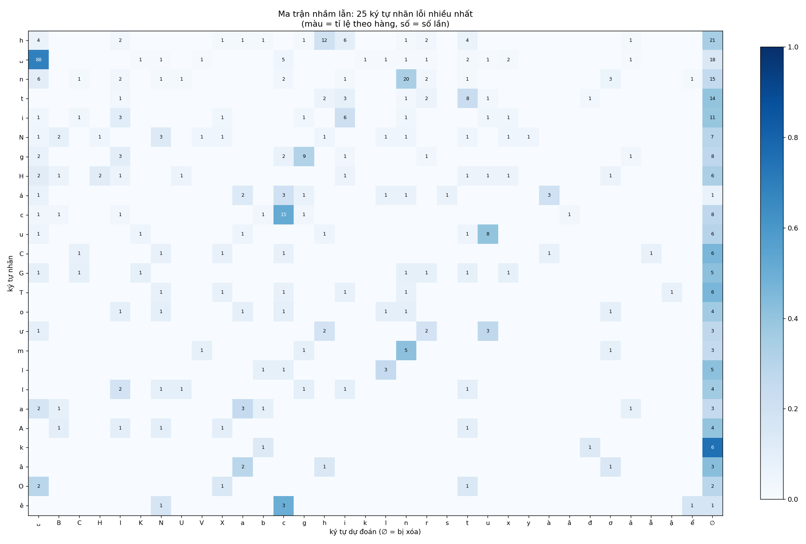

Cặp ký tự (nhãn -> dự đoán; ∅ = bị xóa hoặc thừa):

| Cặp | Số lần | % tổng lỗi | % lần xuất hiện của ký tự nhãn |
|---|---|---|---|
| `h` -> `∅` | 21 | 3.2 | 34.4 |
| `␣` -> `∅` | 18 | 2.7 | 14.1 |
| `n` -> `∅` | 15 | 2.3 | 25.4 |
| `t` -> `∅` | 14 | 2.1 | 40.0 |
| `i` -> `∅` | 11 | 1.7 | 39.3 |
| `c` -> `∅` | 8 | 1.2 | 27.6 |
| `g` -> `∅` | 8 | 1.2 | 27.6 |
| `N` -> `∅` | 7 | 1.1 | 29.2 |
| `u` -> `∅` | 6 | 0.9 | 30.0 |
| `Đ` -> `∅` | 6 | 0.9 | 100.0 |
| `C` -> `∅` | 6 | 0.9 | 46.2 |
| `h` -> `i` | 6 | 0.9 | 9.8 |
| `k` -> `∅` | 6 | 0.9 | 75.0 |
| `n` -> `␣` | 6 | 0.9 | 10.2 |
| `H` -> `∅` | 6 | 0.9 | 33.3 |
| `T` -> `∅` | 6 | 0.9 | 46.2 |
| `l` -> `∅` | 5 | 0.8 | 41.7 |
| `G` -> `∅` | 5 | 0.8 | 41.7 |
| `␣` -> `c` | 5 | 0.8 | 3.9 |
| `m` -> `n` | 5 | 0.8 | 41.7 |

Cụm lỗi liền nhau (cho thấy cả các nhầm lẫn nhiều ký tự như m -> rn):

| Nhãn | Dự đoán | Số lần |
|---|---|---|
| `h` | `∅` | 2 |
| `h` | `i` | 2 |
| `lợ ` | `NK` | 1 |
| `ợ` | `∅` | 1 |
| `tinh` | `CÁ` | 1 |
| `iê` | `ể` | 1 |
| `t` | `∅` | 1 |
| `un` | `∅` | 1 |
| `Ẻo` | `N` | 1 |
| `hoẹ` | `∅` | 1 |
| `bị gậy` | `Niaâ` | 1 |
| `ĐIÊU` | `56` | 1 |

## 4. Nhóm lỗi "ký tự giống nhau"

Nhóm này chiếm 5 lỗi (0.8% tổng lỗi). Nhóm đang xét (sửa được ở `LOOKALIKE_GROUPS`): 0Oo, 1lI, 5Ss, 8B, 2Zz, 6G, 9gq, uv, il, mn, ec.

| Cặp | Số lần nhầm | Số lần ký tự nhãn xuất hiện |
|---|---|---|
| `O` -> `0` | 0 | 7 |
| `0` -> `O` | 0 | 0 |
| `o` -> `0` | 0 | 11 |
| `0` -> `o` | 0 | 0 |
| `l` -> `1` | 0 | 12 |
| `1` -> `l` | 0 | 0 |
| `l` -> `I` | 0 | 12 |
| `I` -> `l` | 0 | 11 |
| `I` -> `1` | 0 | 11 |
| `1` -> `I` | 0 | 0 |
| `S` -> `5` | 0 | 4 |
| `5` -> `S` | 0 | 0 |
| `s` -> `5` | 0 | 4 |
| `5` -> `s` | 0 | 0 |

| Cặp nhiều ký tự | Số lần |
|---|---|
| `cl` -> `d` | 0 |
| `d` -> `cl` | 0 |
| `h` -> `ln` | 0 |
| `ii` -> `u` | 0 |
| `ln` -> `h` | 0 |
| `m` -> `nn` | 0 |
| `m` -> `rn` | 0 |
| `nn` -> `m` | 0 |
| `rn` -> `m` | 0 |
| `u` -> `ii` | 0 |
| `vv` -> `w` | 0 |
| `w` -> `vv` | 0 |

## 5. Lỗi dấu tiếng Việt

Nhãn có 204 ký tự mang dấu (24.1% số ký tự). Phân loại bằng NFD:

|  | Sai loại | Thiếu | Thừa |
|---|---|---|---|
| Dấu thanh (sắc/huyền/hỏi/ngã/nặng) | 6 | 6 | 2 |
| Dấu phụ (mũ/móc/trăng/gạch đ) | 1 | 5 | 2 |

Sai cả hai loại dấu cùng lúc: 4; mất hẳn chữ có dấu: 86.

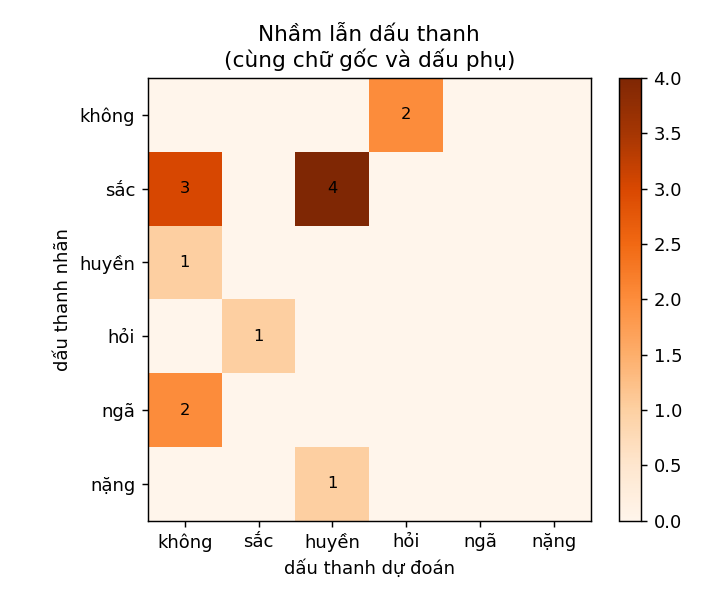

| Loại | Dấu phụ nhãn | Dấu phụ dự đoán | Số lần |
|---|---|---|---|
| Thiếu dấu phụ (â/ă/ê/ô/ơ/ư/đ -> chữ gốc) | móc | ∅ | 3 |
| Thừa dấu phụ (chữ gốc -> â/ă/ê/ô/ơ/ư/đ) | ∅ | móc | 2 |
| Thiếu dấu phụ (â/ă/ê/ô/ơ/ư/đ -> chữ gốc) | mũ | ∅ | 2 |
| Sai dấu phụ (mũ/móc/trăng nhầm nhau) | mũ | móc | 1 |

### CER có dấu so với bỏ dấu

| Cách tính | CER (%) | Word Acc (%) | Giảm so với đầy đủ (điểm %) |
|---|---|---|---|
| đầy đủ | 78.25 | 0.00 | 0.00 |
| bỏ dấu | 74.11 | 0.00 | 4.14 |
| bỏ hoa/thường | 76.60 | 0.00 | 1.65 |
| bỏ dấu + hoa/thường | 72.10 | 0.00 | 6.15 |

Bỏ dấu khỏi cả nhãn lẫn dự đoán làm CER giảm 4.14 điểm (5.3% của CER), Word Acc tăng 0.00 điểm. Đây là **ước lượng** phần lỗi do dấu: bỏ dấu cũng làm thay đổi các lỗi khác (vd. đ -> d), nên con số không tách bạch tuyệt đối.

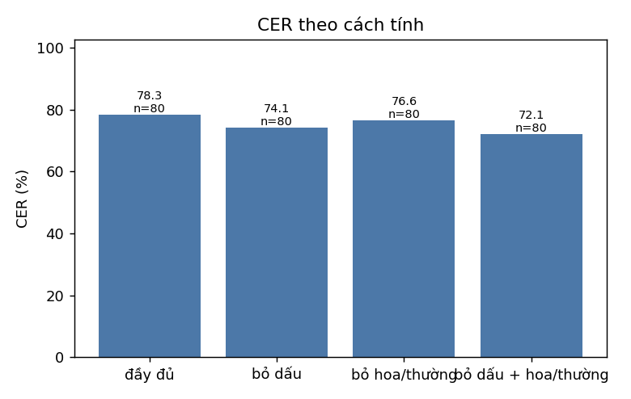

## 6. Lỗi theo đặc trưng của mẫu

Mỗi bảng ghi rõ số mẫu `n`; nhóm nhỏ (n < 30) có độ nhiễu cao.

### Theo độ dài nhãn (số ký tự)

| Nhóm | n | CER (%) | Word Acc (%) |
|---|---|---|---|
| 1-5 | 6 | 84.00 | 0.00 |
| 6-10 | 44 | 75.99 | 0.00 |
| 11-15 | 16 | 79.91 | 0.00 |
| 16-20 | 12 | 79.33 | 0.00 |
| 21+ | 2 | 80.00 | 0.00 |

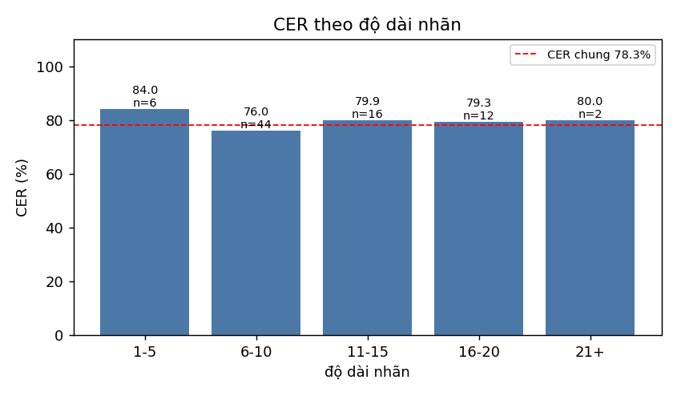

### Theo kiểu chữ

| Nhóm | n | CER (%) | Word Acc (%) |
|---|---|---|---|
| CHỮ HOA | 18 | 87.83 | 0.00 |
| Viết Hoa Từng Từ | 12 | 79.70 | 0.00 |
| chữ thường | 36 | 74.58 | 0.00 |
| Hoa đầu câu/hỗn hợp | 14 | 74.10 | 0.00 |

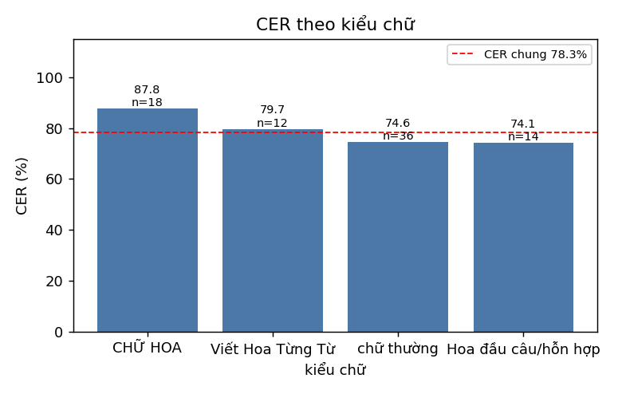

### Theo T/(L+R) (T = rộng@H=32 chia 4; càng thấp càng sát giới hạn CTC)

| Nhóm | n | CER (%) | Word Acc (%) |
|---|---|---|---|
| 1.5-2 | 12 | 77.01 | 0.00 |
| 2-3 | 60 | 77.56 | 0.00 |
| >=3 | 8 | 87.88 | 0.00 |

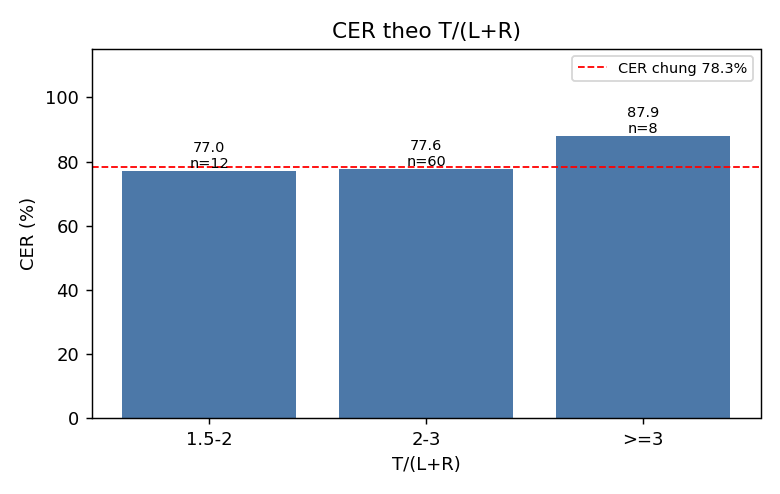

### Theo độ tương phản ảnh (độ lệch chuẩn điểm ảnh)

| Nhóm | n | CER (%) | Word Acc (%) |
|---|---|---|---|
| Q1 (tương phản thấp nhất) | 20 | 88.16 | 0.00 |
| Q2 | 20 | 77.29 | 0.00 |
| Q3 | 20 | 73.04 | 0.00 |
| Q4 (cao nhất) | 20 | 72.97 | 0.00 |

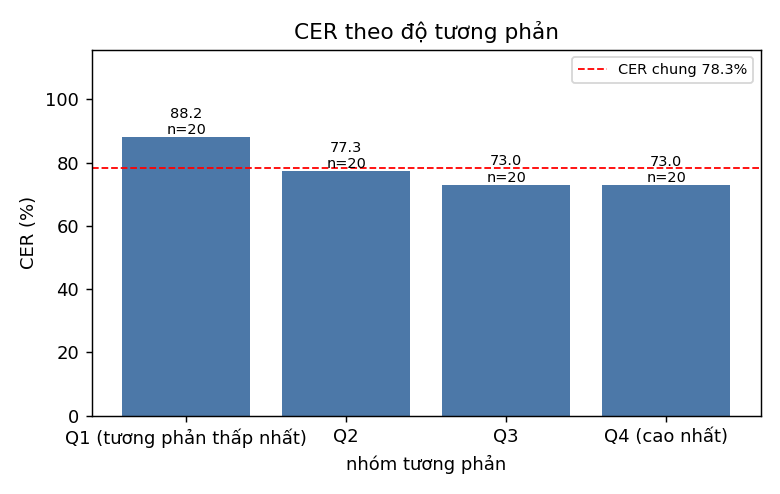

## 7. Ví dụ dự đoán

Dự đoán đúng được chọn ngẫu nhiên có seed; dự đoán sai được chọn lần lượt từ loại lỗi phổ biến nhất, ưu tiên mẫu ít lỗi cho dễ đọc (không chọn theo cảm tính). Cột nguyên nhân là **giả thuyết** suy từ loại lỗi và các đặc trưng đo được của ảnh, chưa kiểm chứng bằng thí nghiệm.

### 10 dự đoán sai

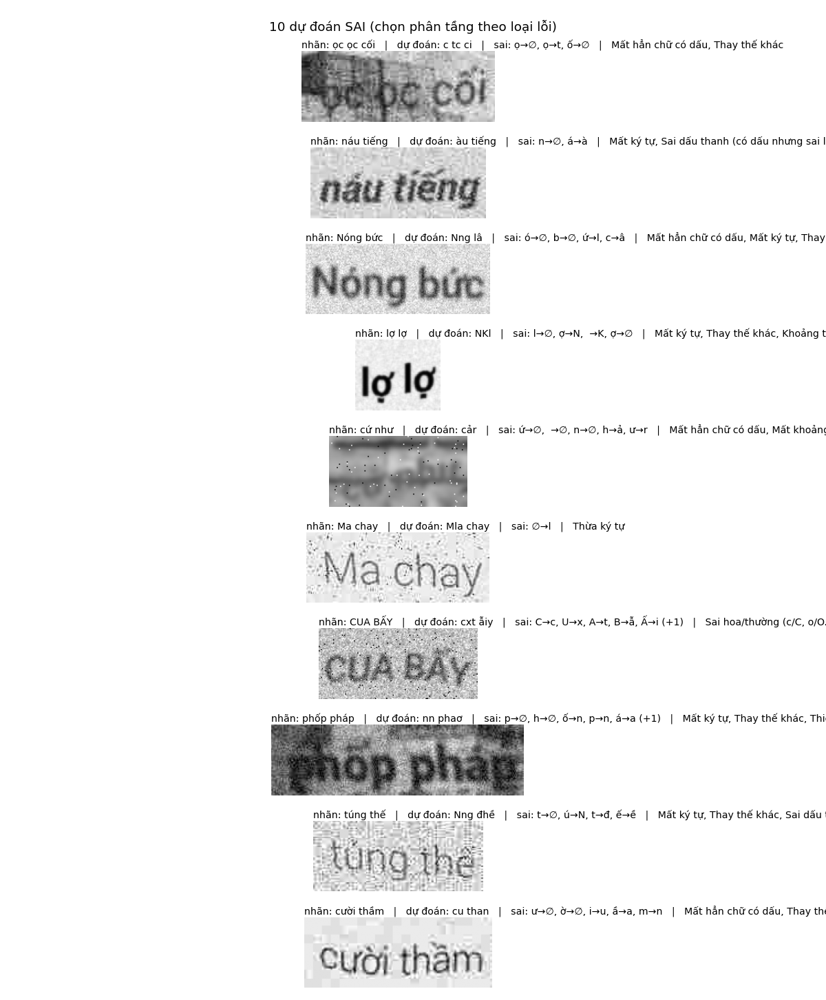

| # | Ảnh | Nhãn | Dự đoán | Chỗ sai | Loại lỗi | Nhận xét nguyên nhân |
|---|---|---|---|---|---|---|
| 1 | 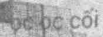 | `ọc ọc cối` | `c tc ci` | `ọ→∅, ọ→t, ố→∅` | Mất hẳn chữ có dấu, Thay thế khác | mất hẳn chữ có dấu: chữ có dấu bị bỏ hẳn, thường do T hẹp, ảnh mờ hoặc mô hình thiên về blank; thay thế khác: nhầm hai ký tự không thuộc nhóm nào ở trên |
| 2 | 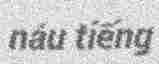 | `náu tiếng` | `àu tiếng` | `n→∅, á→à` | Mất ký tự, Sai dấu thanh (có dấu nhưng sai loại) | mất ký tự: ký tự bị bỏ sót: T hẹp so với nhãn, nét mờ hoặc mô hình chưa hội tụ; sai dấu thanh (có dấu nhưng sai loại): dấu thanh là nét nhỏ, dễ bị nhầm loại khi ảnh bị thu nhỏ hoặc nhiễu |
| 3 | 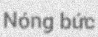 | `Nóng bức` | `Nng lâ` | `ó→∅, b→∅, ứ→l, c→â` | Mất hẳn chữ có dấu, Mất ký tự, Thay thế khác | thay thế khác: nhầm hai ký tự không thuộc nhóm nào ở trên; mất hẳn chữ có dấu: chữ có dấu bị bỏ hẳn, thường do T hẹp, ảnh mờ hoặc mô hình thiên về blank; mất ký tự: ký tự bị bỏ sót: T hẹp so với nhãn, nét mờ hoặc mô hình chưa hội tụ |
| 4 | 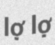 | `lợ lợ` | `NKl` | `l→∅, ợ→N,  →K, ợ→∅` | Mất ký tự, Thay thế khác, Khoảng trắng bị thay, Mất hẳn chữ có dấu | mất ký tự: ký tự bị bỏ sót: T hẹp so với nhãn, nét mờ hoặc mô hình chưa hội tụ; thay thế khác: nhầm hai ký tự không thuộc nhóm nào ở trên; khoảng trắng bị thay: khoảng trắng hẹp hoặc rộng tùy font nên ranh giới từ khó xác định |
| 5 | 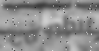 | `cứ như` | `cảr` | `ứ→∅,  →∅, n→∅, h→ả, ư→r` | Mất hẳn chữ có dấu, Mất khoảng trắng, Mất ký tự, Thay thế khác | thay thế khác: nhầm hai ký tự không thuộc nhóm nào ở trên; mất hẳn chữ có dấu: chữ có dấu bị bỏ hẳn, thường do T hẹp, ảnh mờ hoặc mô hình thiên về blank; mất khoảng trắng: khoảng trắng hẹp bị bỏ qua |
| 6 | 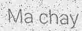 | `Ma chay` | `Mla chay` | `∅→l` | Thừa ký tự | thừa ký tự: nhiễu nền hoặc nét đứt bị đọc thành ký tự thừa |
| 7 | 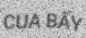 | `CUA BẤY` | `cxt ẫiy` | `C→c, U→x, A→t, B→ẫ, Ấ→i (+1)` | Sai hoa/thường (c/C, o/O...), Thay thế khác | thay thế khác: nhầm hai ký tự không thuộc nhóm nào ở trên; sai hoa/thường (c/c, o/o...): chữ hoa và thường cùng hình dạng, chỉ khác kích thước |
| 8 | 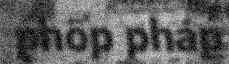 | `phốp pháp` | `nn phaơ` | `p→∅, h→∅, ố→n, p→n, á→a (+1)` | Mất ký tự, Thay thế khác, Thiếu dấu thanh | thay thế khác: nhầm hai ký tự không thuộc nhóm nào ở trên; mất ký tự: ký tự bị bỏ sót: T hẹp so với nhãn, nét mờ hoặc mô hình chưa hội tụ; thiếu dấu thanh: dấu thanh mảnh bị mờ/mất sau khi resize hoặc bị nền nhiễu che |
| 9 | 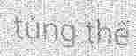 | `túng thế` | `Nng đhề` | `t→∅, ú→N, t→đ, ế→ề` | Mất ký tự, Thay thế khác, Sai dấu thanh (có dấu nhưng sai loại) | thay thế khác: nhầm hai ký tự không thuộc nhóm nào ở trên; mất ký tự: ký tự bị bỏ sót: T hẹp so với nhãn, nét mờ hoặc mô hình chưa hội tụ; sai dấu thanh (có dấu nhưng sai loại): dấu thanh là nét nhỏ, dễ bị nhầm loại khi ảnh bị thu nhỏ hoặc nhiễu |
| 10 | 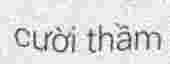 | `cười thầm` | `cu than` | `ư→∅, ờ→∅, i→u, ầ→a, m→n` | Mất hẳn chữ có dấu, Thay thế khác, Sai cả dấu phụ lẫn dấu thanh, Ký tự giống nhau (O/0, l/1/I, S/5...) | mất hẳn chữ có dấu: chữ có dấu bị bỏ hẳn, thường do T hẹp, ảnh mờ hoặc mô hình thiên về blank; thay thế khác: nhầm hai ký tự không thuộc nhóm nào ở trên; sai cả dấu phụ lẫn dấu thanh: chữ có nhiều dấu chồng nhau, cả hai dấu đều bị mất hoặc sai |

(Không có dự đoán nào khớp hoàn toàn nên không có ví dụ đúng.)

## 8. Đề xuất cải thiện (rút ra từ số liệu ở trên)

Mỗi đề xuất kèm con số quan sát được. Đây là tương quan từ một lần đánh giá, chưa phải bằng chứng nhân quả: cách kiểm chứng là thay đổi đúng một yếu tố và chạy lại `eval.py` + phân tích này.

1. **Ưu tiên 1: khoảng cách khái quát hóa, không phải thiếu huấn luyện.** CER = 78.3% và Word Acc = 0.0% (khoảng tin cậy CER 95%: 74.8-81.4%). Cùng mô hình đạt val CER 1.6% trên phân phối huấn luyện, tức là đã hội tụ ở đó nhưng suy giảm 48.3 lần ở tập này. Tập này khác phân phối (ví dụ font chưa thấy, nhiễu/mờ nặng) nên huấn luyện thêm trên cùng dữ liệu khó có thể giúp. Để tách nguyên nhân: sinh hai tập mới, một tập dùng font của train + augmentation nặng, một tập dùng font lạ + augmentation thường, rồi so CER; sau đó đưa một phần augmentation nặng và nhiều họ font hơn vào train.
2. **Mất ký tự chiếm 41.2% số lỗi** (D = 291 so với S = 361, I = 10). Thử `configs/model_s2.yaml` (stride 2) hoặc `model_h48.yaml` và so sánh số lỗi D trước/sau.
3. **Lỗi khoảng trắng chiếm 11.5% số lỗi.** Xem xét đánh giá thêm theo từ, hoặc tăng tỉ lệ dòng nhiều từ trong dữ liệu.

## 9. Phương pháp và giới hạn

- Căn chỉnh bằng Levenshtein DP (khớp/thay > xóa > chèn khi hòa); căn chỉnh tối thiểu không duy nhất nên cặp nhầm lẫn phụ thuộc quy tắc hòa.
- Mỗi thao tác lỗi thuộc đúng một loại; cụm lỗi khớp m<->rn, cl<->d... được gán 'cặp giống nhau' cho toàn cụm.
- Chữ gốc và dấu tách bằng `unicodedata` NFD; 'đ' xử lý riêng (gạch ngang). Khi cả dấu phụ và dấu thanh cùng sai thì xếp vào loại 'sai cả hai'.
- Họ font suy ra từ tên file; T/(L+R) tính với `--img_height` và `--stride` đã khai báo (mặc định 32 và 4).
