# Phân tích lỗi: overfit200_vi_ft / vi_test_greedy

> **Lưu ý:** CER tập này (51.4%) cao gấp 31.7 lần val CER của cùng mô hình (1.6%): mô hình đã hội tụ trên phân phối huấn luyện, còn tập này khó hoặc khác phân phối.

## 1. Tổng quan

| Chỉ số | Giá trị |
|---|---|
| Số mẫu / số ký tự nhãn | 80 / 796 |
| CER | 51.38% (95% CI: 46.18-56.73%) |
| Word Accuracy (khớp hoàn toàn) | 1.25% (95% CI: 0.00-3.75%) |
| Thay thế S / Xóa D / Chèn I | 272 / 116 / 21  (34.17% / 14.57% / 2.64% số ký tự nhãn) |

Khoảng tin cậy bootstrap theo mẫu (1000 lần). CER = (S+D+I)/N gộp toàn tập.

## 2. Phân bố lỗi theo loại

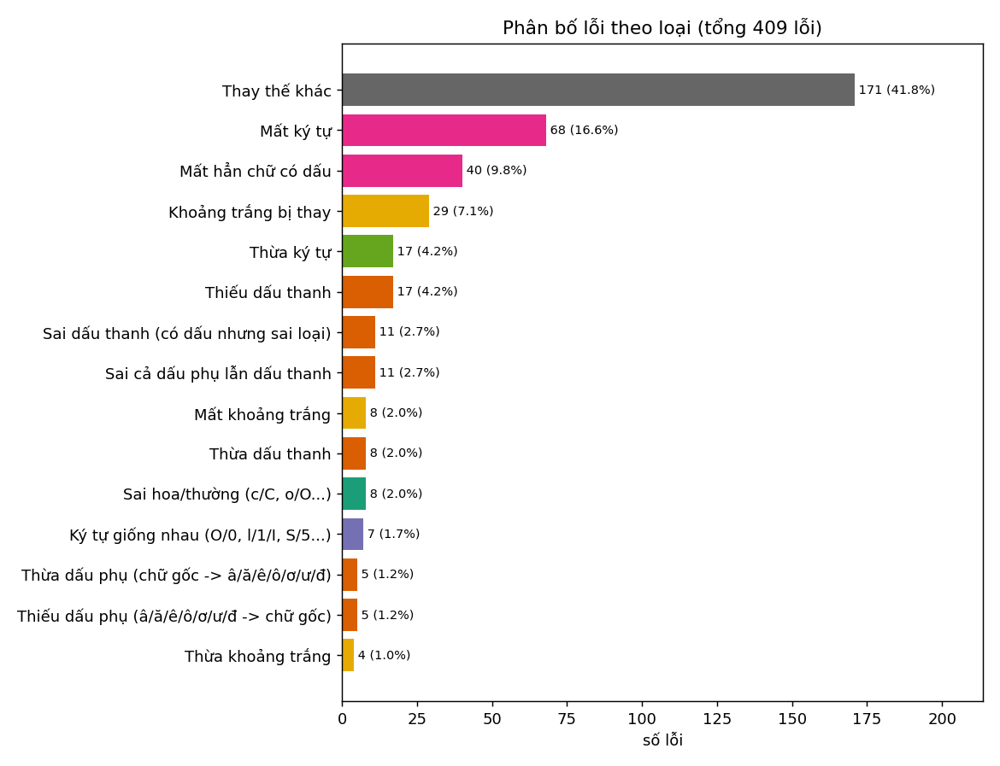

| Loại lỗi | Nhóm | Số lỗi | % tổng lỗi |
|---|---|---|---|
| Thay thế khác | Thay thế khác | 171 | 41.8 |
| Mất ký tự | Mất ký tự | 68 | 16.6 |
| Mất hẳn chữ có dấu | Mất ký tự | 40 | 9.8 |
| Khoảng trắng bị thay | Khoảng trắng | 29 | 7.1 |
| Thiếu dấu thanh | Lỗi dấu tiếng Việt | 17 | 4.2 |
| Thừa ký tự | Thừa ký tự | 17 | 4.2 |
| Sai cả dấu phụ lẫn dấu thanh | Lỗi dấu tiếng Việt | 11 | 2.7 |
| Sai dấu thanh (có dấu nhưng sai loại) | Lỗi dấu tiếng Việt | 11 | 2.7 |
| Sai hoa/thường (c/C, o/O...) | Hoa/thường | 8 | 2.0 |
| Thừa dấu thanh | Lỗi dấu tiếng Việt | 8 | 2.0 |
| Mất khoảng trắng | Khoảng trắng | 8 | 2.0 |
| Ký tự giống nhau (O/0, l/1/I, S/5...) | Ký tự giống nhau | 7 | 1.7 |
| Thiếu dấu phụ (â/ă/ê/ô/ơ/ư/đ -> chữ gốc) | Lỗi dấu tiếng Việt | 5 | 1.2 |
| Thừa dấu phụ (chữ gốc -> â/ă/ê/ô/ơ/ư/đ) | Lỗi dấu tiếng Việt | 5 | 1.2 |
| Thừa khoảng trắng | Khoảng trắng | 4 | 1.0 |

Theo nhóm lớn: Thay thế khác 171 (41.8%); Mất ký tự 108 (26.4%); Lỗi dấu tiếng Việt 57 (13.9%); Khoảng trắng 41 (10.0%); Thừa ký tự 17 (4.2%); Hoa/thường 8 (2.0%); Ký tự giống nhau 7 (1.7%)

## 3. Ma trận nhầm lẫn và top-20 cặp nhầm lẫn

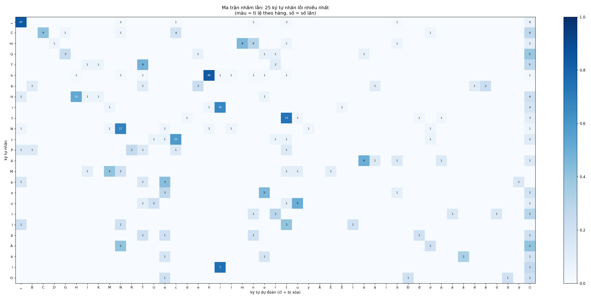

Cặp ký tự (nhãn -> dự đoán; ∅ = bị xóa hoặc thừa):

| Cặp | Số lần | % tổng lỗi | % lần xuất hiện của ký tự nhãn |
|---|---|---|---|
| `␣` -> `∅` | 8 | 2.0 | 7.0 |
| `C` -> `∅` | 6 | 1.5 | 27.3 |
| `m` -> `n` | 6 | 1.5 | 30.0 |
| `G` -> `∅` | 5 | 1.2 | 38.5 |
| `T` -> `∅` | 5 | 1.2 | 26.3 |
| `ả` -> `á` | 4 | 1.0 | 50.0 |
| `H` -> `∅` | 4 | 1.0 | 21.1 |
| `i` -> `∅` | 4 | 1.0 | 16.7 |
| `∅` -> `␣` | 4 | 1.0 | — |
| `C` -> `c` | 4 | 1.0 | 18.2 |
| `í` -> `i` | 3 | 0.7 | 75.0 |
| `ó` -> `∅` | 3 | 0.7 | 100.0 |
| `ạ` -> `a` | 3 | 0.7 | 42.9 |
| `o` -> `a` | 3 | 0.7 | 27.3 |
| `R` -> `∅` | 3 | 0.7 | 75.0 |
| `ố` -> `∅` | 3 | 0.7 | 75.0 |
| `g` -> `∅` | 3 | 0.7 | 14.3 |
| `t` -> `∅` | 3 | 0.7 | 9.7 |
| `ê` -> `e` | 2 | 0.5 | 22.2 |
| `ê` -> `ệ` | 2 | 0.5 | 22.2 |

Cụm lỗi liền nhau (cho thấy cả các nhầm lẫn nhiều ký tự như m -> rn):

| Nhãn | Dự đoán | Số lần |
|---|---|---|
| `C` | `∅` | 3 |
| `t` | `∅` | 3 |
| `ả` | `á` | 3 |
| `í` | `i` | 2 |
| `G` | `∅` | 2 |
| `ạ` | `a` | 2 |
| `ế` | `∅` | 2 |
| `o` | `a` | 2 |
| `Â` | `∅` | 2 |
| `H` | `∅` | 2 |
| `ố` | `∅` | 2 |
| ` ` | `∅` | 2 |

## 4. Nhóm lỗi "ký tự giống nhau"

Nhóm này chiếm 7 lỗi (1.7% tổng lỗi). Nhóm đang xét (sửa được ở `LOOKALIKE_GROUPS`): 0Oo, 1lI, 5Ss, 8B, 2Zz, 6G, 9gq, uv, il, mn, ec.

| Cặp | Số lần nhầm | Số lần ký tự nhãn xuất hiện |
|---|---|---|
| `O` -> `0` | 0 | 5 |
| `0` -> `O` | 1 | 2 |
| `o` -> `0` | 0 | 11 |
| `0` -> `o` | 0 | 2 |
| `l` -> `1` | 0 | 7 |
| `1` -> `l` | 0 | 3 |
| `l` -> `I` | 0 | 7 |
| `I` -> `l` | 0 | 5 |
| `I` -> `1` | 0 | 5 |
| `1` -> `I` | 0 | 3 |
| `S` -> `5` | 0 | 3 |
| `5` -> `S` | 0 | 1 |
| `s` -> `5` | 0 | 2 |
| `5` -> `s` | 0 | 1 |

| Cặp nhiều ký tự | Số lần |
|---|---|
| `cl` -> `d` | 0 |
| `d` -> `cl` | 0 |
| `h` -> `ln` | 0 |
| `ii` -> `u` | 0 |
| `ln` -> `h` | 0 |
| `m` -> `nn` | 0 |
| `m` -> `rn` | 0 |
| `nn` -> `m` | 0 |
| `rn` -> `m` | 0 |
| `u` -> `ii` | 0 |
| `vv` -> `w` | 0 |
| `w` -> `vv` | 0 |

## 5. Lỗi dấu tiếng Việt

Nhãn có 187 ký tự mang dấu (23.5% số ký tự). Phân loại bằng NFD:

|  | Sai loại | Thiếu | Thừa |
|---|---|---|---|
| Dấu thanh (sắc/huyền/hỏi/ngã/nặng) | 11 | 17 | 8 |
| Dấu phụ (mũ/móc/trăng/gạch đ) | 0 | 5 | 5 |

Sai cả hai loại dấu cùng lúc: 11; mất hẳn chữ có dấu: 40.

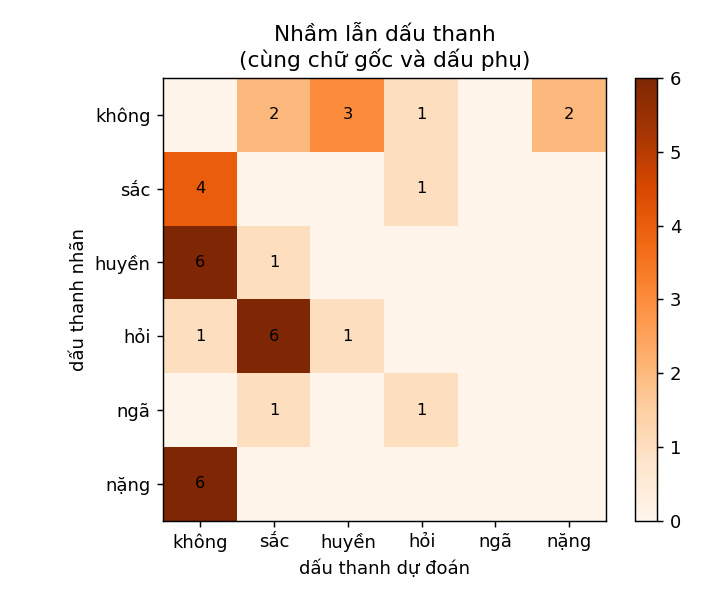

| Loại | Dấu phụ nhãn | Dấu phụ dự đoán | Số lần |
|---|---|---|---|
| Thừa dấu phụ (chữ gốc -> â/ă/ê/ô/ơ/ư/đ) | ∅ | mũ | 4 |
| Thiếu dấu phụ (â/ă/ê/ô/ơ/ư/đ -> chữ gốc) | mũ | ∅ | 3 |
| Thiếu dấu phụ (â/ă/ê/ô/ơ/ư/đ -> chữ gốc) | móc | ∅ | 2 |
| Thừa dấu phụ (chữ gốc -> â/ă/ê/ô/ơ/ư/đ) | ∅ | móc | 1 |

### CER có dấu so với bỏ dấu

| Cách tính | CER (%) | Word Acc (%) | Giảm so với đầy đủ (điểm %) |
|---|---|---|---|
| đầy đủ | 51.38 | 1.25 | 0.00 |
| bỏ dấu | 43.97 | 3.75 | 7.41 |
| bỏ hoa/thường | 50.38 | 1.25 | 1.01 |
| bỏ dấu + hoa/thường | 42.21 | 5.00 | 9.17 |

Bỏ dấu khỏi cả nhãn lẫn dự đoán làm CER giảm 7.41 điểm (14.4% của CER), Word Acc tăng 2.50 điểm. Đây là **ước lượng** phần lỗi do dấu: bỏ dấu cũng làm thay đổi các lỗi khác (vd. đ -> d), nên con số không tách bạch tuyệt đối.

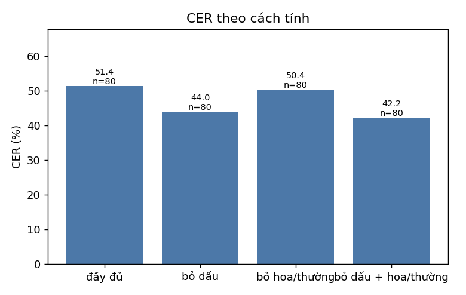

## 6. Lỗi theo đặc trưng của mẫu

Mỗi bảng ghi rõ số mẫu `n`; nhóm nhỏ (n < 30) có độ nhiễu cao.

### Theo độ dài nhãn (số ký tự)

| Nhóm | n | CER (%) | Word Acc (%) |
|---|---|---|---|
| 1-5 | 12 | 79.17 | 0.00 |
| 6-10 | 41 | 44.03 | 2.44 |
| 11-15 | 11 | 53.79 | 0.00 |
| 16-20 | 14 | 54.36 | 0.00 |
| 21+ | 2 | 50.00 | 0.00 |

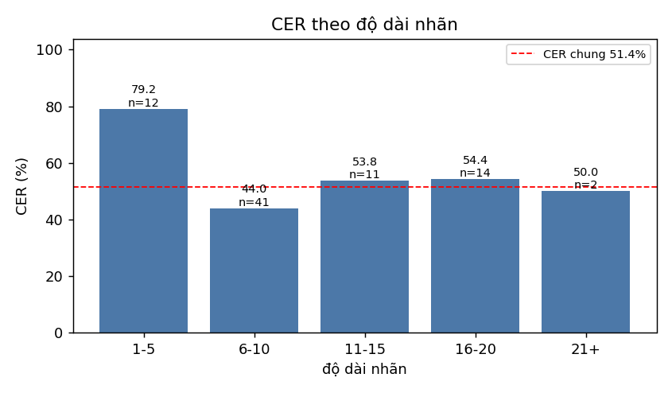

### Theo kiểu chữ

| Nhóm | n | CER (%) | Word Acc (%) |
|---|---|---|---|
| có chữ số/mã | 5 | 80.00 | 0.00 |
| CHỮ HOA | 18 | 67.02 | 0.00 |
| Viết Hoa Từng Từ | 13 | 56.74 | 0.00 |
| Hoa đầu câu/hỗn hợp | 11 | 50.76 | 0.00 |
| chữ thường | 33 | 35.69 | 3.03 |

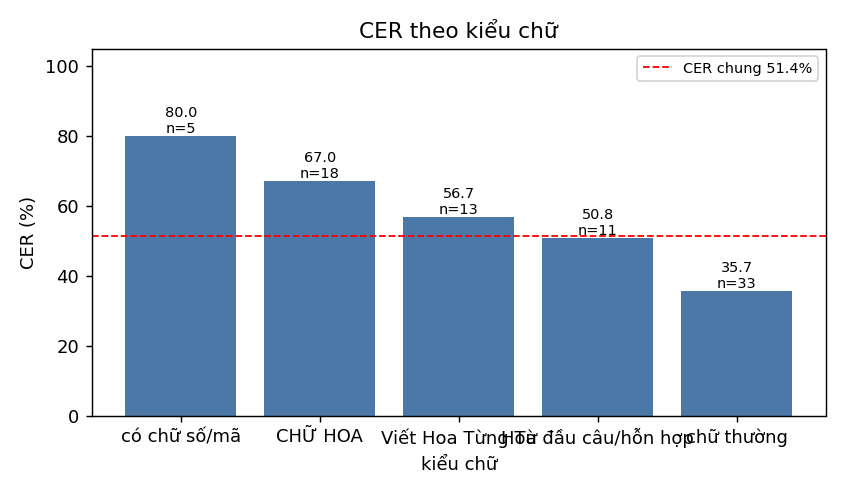

### Theo T/(L+R) (T = rộng@H=32 chia 4; càng thấp càng sát giới hạn CTC)

| Nhóm | n | CER (%) | Word Acc (%) |
|---|---|---|---|
| 1.5-2 | 2 | 52.17 | 0.00 |
| 2-3 | 51 | 50.68 | 1.96 |
| >=3 | 27 | 53.55 | 0.00 |

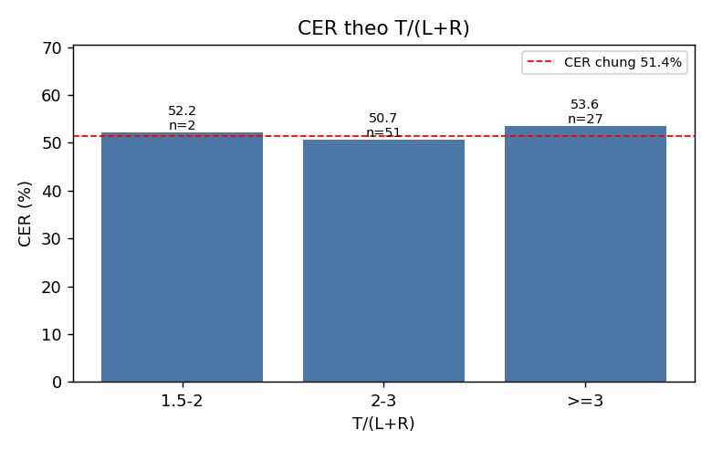

### Theo độ tương phản ảnh (độ lệch chuẩn điểm ảnh)

| Nhóm | n | CER (%) | Word Acc (%) |
|---|---|---|---|
| Q1 (tương phản thấp nhất) | 20 | 55.11 | 0.00 |
| Q2 | 20 | 55.34 | 0.00 |
| Q3 | 20 | 55.25 | 0.00 |
| Q4 (cao nhất) | 20 | 38.59 | 5.00 |

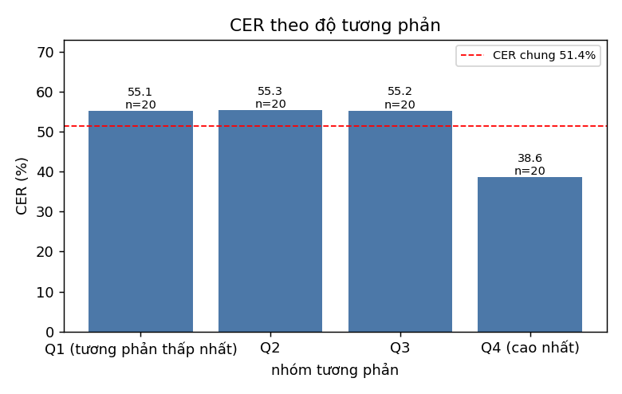

## 7. Ví dụ dự đoán

Dự đoán đúng được chọn ngẫu nhiên có seed; dự đoán sai được chọn lần lượt từ loại lỗi phổ biến nhất, ưu tiên mẫu ít lỗi cho dễ đọc (không chọn theo cảm tính). Cột nguyên nhân là **giả thuyết** suy từ loại lỗi và các đặc trưng đo được của ảnh, chưa kiểm chứng bằng thí nghiệm.

### 10 dự đoán đúng

| # | Ảnh | Nhãn = dự đoán | Font |
|---|---|---|---|
| 1 | 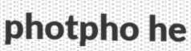 | `photpho he` | None |

### 10 dự đoán sai

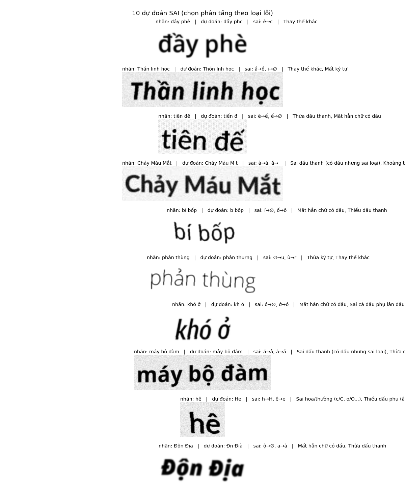

| # | Ảnh | Nhãn | Dự đoán | Chỗ sai | Loại lỗi | Nhận xét nguyên nhân |
|---|---|---|---|---|---|---|
| 1 | 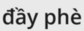 | `đầy phè` | `đầy phc` | `è→c` | Thay thế khác | thay thế khác: nhầm hai ký tự không thuộc nhóm nào ở trên |
| 2 | 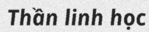 | `Thần linh học` | `Thồn lnh học` | `ầ→ồ, i→∅` | Thay thế khác, Mất ký tự | thay thế khác: nhầm hai ký tự không thuộc nhóm nào ở trên; mất ký tự: ký tự bị bỏ sót: T hẹp so với nhãn, nét mờ hoặc mô hình chưa hội tụ |
| 3 |  | `tiên đế` | `tiến đ` | `ê→ế, ế→∅` | Thừa dấu thanh, Mất hẳn chữ có dấu | thừa dấu thanh: nhiễu/nét nền bị đọc thành dấu thanh; mất hẳn chữ có dấu: chữ có dấu bị bỏ hẳn, thường do T hẹp, ảnh mờ hoặc mô hình thiên về blank |
| 4 | 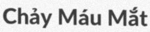 | `Chảy Máu Mắt` | `Cháy Máu M t` | `ả→á, ắ→ ` | Sai dấu thanh (có dấu nhưng sai loại), Khoảng trắng bị thay | sai dấu thanh (có dấu nhưng sai loại): dấu thanh là nét nhỏ, dễ bị nhầm loại khi ảnh bị thu nhỏ hoặc nhiễu; khoảng trắng bị thay: khoảng trắng hẹp hoặc rộng tùy font nên ranh giới từ khó xác định |
| 5 | 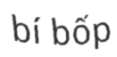 | `bí bốp` | `b bôp` | `í→∅, ố→ô` | Mất hẳn chữ có dấu, Thiếu dấu thanh | mất hẳn chữ có dấu: chữ có dấu bị bỏ hẳn, thường do T hẹp, ảnh mờ hoặc mô hình thiên về blank; thiếu dấu thanh: dấu thanh mảnh bị mờ/mất sau khi resize hoặc bị nền nhiễu che |
| 6 |  | `phản thùng` | `phản thurng` | `∅→u, ù→r` | Thừa ký tự, Thay thế khác | thừa ký tự: nhiễu nền hoặc nét đứt bị đọc thành ký tự thừa; thay thế khác: nhầm hai ký tự không thuộc nhóm nào ở trên | bối cảnh đo được: ảnh thuộc nhóm tương phản thấp nhất 25% |
| 7 | 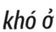 | `khó ở` | `kh ó` | `ó→∅, ở→ó` | Mất hẳn chữ có dấu, Sai cả dấu phụ lẫn dấu thanh | mất hẳn chữ có dấu: chữ có dấu bị bỏ hẳn, thường do T hẹp, ảnh mờ hoặc mô hình thiên về blank; sai cả dấu phụ lẫn dấu thanh: chữ có nhiều dấu chồng nhau, cả hai dấu đều bị mất hoặc sai |
| 8 | 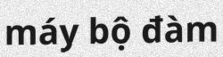 | `máy bộ đàm` | `mảy bộ đầm` | `á→ả, à→ầ` | Sai dấu thanh (có dấu nhưng sai loại), Thừa dấu phụ (chữ gốc -> â/ă/ê/ô/ơ/ư/đ) | sai dấu thanh (có dấu nhưng sai loại): dấu thanh là nét nhỏ, dễ bị nhầm loại khi ảnh bị thu nhỏ hoặc nhiễu; thừa dấu phụ (chữ gốc -> â/ă/ê/ô/ơ/ư/đ): nét nhỏ trên chữ bị đọc thành dấu phụ |
| 9 | 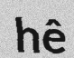 | `hê` | `He` | `h→H, ê→e` | Sai hoa/thường (c/C, o/O...), Thiếu dấu phụ (â/ă/ê/ô/ơ/ư/đ -> chữ gốc) | sai hoa/thường (c/c, o/o...): chữ hoa và thường cùng hình dạng, chỉ khác kích thước; thiếu dấu phụ (â/ă/ê/ô/ơ/ư/đ -> chữ gốc): dấu mũ/móc/trăng nhỏ, gần như trùng hình với chữ gốc ở độ phân giải thấp |
| 10 |  | `Độn Địa` | `Đn Địà` | `ộ→∅, a→à` | Mất hẳn chữ có dấu, Thừa dấu thanh | mất hẳn chữ có dấu: chữ có dấu bị bỏ hẳn, thường do T hẹp, ảnh mờ hoặc mô hình thiên về blank; thừa dấu thanh: nhiễu/nét nền bị đọc thành dấu thanh |

## 8. Đề xuất cải thiện (rút ra từ số liệu ở trên)

Mỗi đề xuất kèm con số quan sát được. Đây là tương quan từ một lần đánh giá, chưa phải bằng chứng nhân quả: cách kiểm chứng là thay đổi đúng một yếu tố và chạy lại `eval.py` + phân tích này.

1. **Ưu tiên 1: khoảng cách khái quát hóa, không phải thiếu huấn luyện.** CER = 51.4% và Word Acc = 1.2% (khoảng tin cậy CER 95%: 46.2-56.7%). Cùng mô hình đạt val CER 1.6% trên phân phối huấn luyện, tức là đã hội tụ ở đó nhưng suy giảm 31.7 lần ở tập này. Tập này khác phân phối (ví dụ font chưa thấy, nhiễu/mờ nặng) nên huấn luyện thêm trên cùng dữ liệu khó có thể giúp. Để tách nguyên nhân: sinh hai tập mới, một tập dùng font của train + augmentation nặng, một tập dùng font lạ + augmentation thường, rồi so CER; sau đó đưa một phần augmentation nặng và nhiều họ font hơn vào train.
2. **Lỗi khoảng trắng chiếm 10.0% số lỗi.** Xem xét đánh giá thêm theo từ, hoặc tăng tỉ lệ dòng nhiều từ trong dữ liệu.
3. **Ảnh tương phản thấp khó hơn rõ rệt**: CER 55.1% (25% ảnh tương phản thấp nhất) so với 38.6% (25% cao nhất). Thử chuẩn hóa tương phản từng ảnh (vd. CLAHE) hoặc tăng augmentation tương phản.

## 9. Phương pháp và giới hạn

- Căn chỉnh bằng Levenshtein DP (khớp/thay > xóa > chèn khi hòa); căn chỉnh tối thiểu không duy nhất nên cặp nhầm lẫn phụ thuộc quy tắc hòa.
- Mỗi thao tác lỗi thuộc đúng một loại; cụm lỗi khớp m<->rn, cl<->d... được gán 'cặp giống nhau' cho toàn cụm.
- Chữ gốc và dấu tách bằng `unicodedata` NFD; 'đ' xử lý riêng (gạch ngang). Khi cả dấu phụ và dấu thanh cùng sai thì xếp vào loại 'sai cả hai'.
- Họ font suy ra từ tên file; T/(L+R) tính với `--img_height` và `--stride` đã khai báo (mặc định 32 và 4).
