# Phân tích lỗi: vi_finetune / vi_hard_greedy

> **Cảnh báo độ tin cậy:** CER = 94.9% rất cao, cùng mức với val CER (94.3%) nên mô hình có thể chưa hội tụ; phần phân loại lỗi mang tính chỉ hướng.

## 1. Tổng quan

| Chỉ số | Giá trị |
|---|---|
| Số mẫu / số ký tự nhãn | 80 / 846 |
| CER | 94.92% (95% CI: 93.77-96.12%) |
| Word Accuracy (khớp hoàn toàn) | 0.00% (95% CI: 0.00-0.00%) |
| Thay thế S / Xóa D / Chèn I | 144 / 659 / 0  (17.02% / 77.90% / 0.00% số ký tự nhãn) |

Khoảng tin cậy bootstrap theo mẫu (1000 lần). CER = (S+D+I)/N gộp toàn tập.

## 2. Phân bố lỗi theo loại

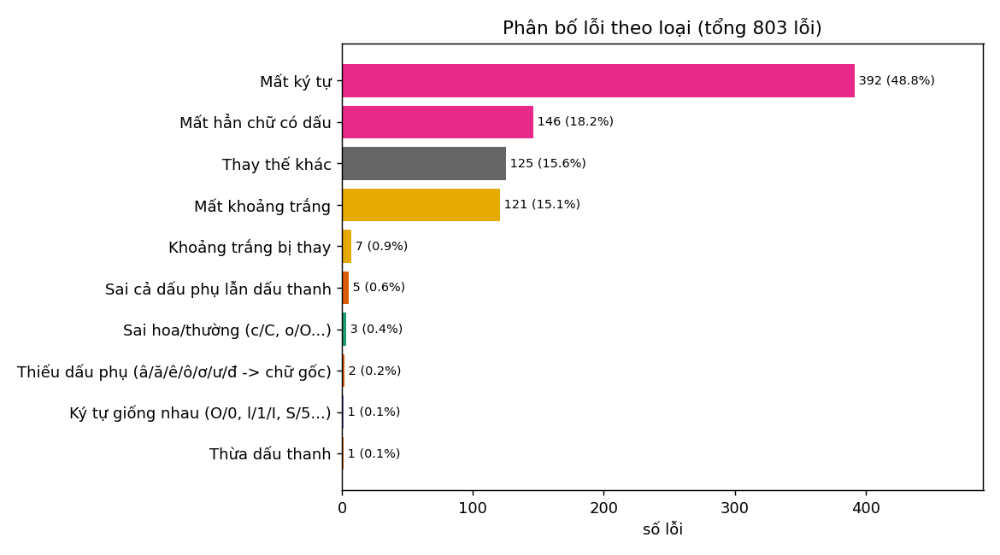

| Loại lỗi | Nhóm | Số lỗi | % tổng lỗi |
|---|---|---|---|
| Mất ký tự | Mất ký tự | 392 | 48.8 |
| Mất hẳn chữ có dấu | Mất ký tự | 146 | 18.2 |
| Thay thế khác | Thay thế khác | 125 | 15.6 |
| Mất khoảng trắng | Khoảng trắng | 121 | 15.1 |
| Khoảng trắng bị thay | Khoảng trắng | 7 | 0.9 |
| Sai cả dấu phụ lẫn dấu thanh | Lỗi dấu tiếng Việt | 5 | 0.6 |
| Sai hoa/thường (c/C, o/O...) | Hoa/thường | 3 | 0.4 |
| Thiếu dấu phụ (â/ă/ê/ô/ơ/ư/đ -> chữ gốc) | Lỗi dấu tiếng Việt | 2 | 0.2 |
| Thừa dấu thanh | Lỗi dấu tiếng Việt | 1 | 0.1 |
| Ký tự giống nhau (O/0, l/1/I, S/5...) | Ký tự giống nhau | 1 | 0.1 |

Theo nhóm lớn: Mất ký tự 538 (67.0%); Khoảng trắng 128 (15.9%); Thay thế khác 125 (15.6%); Lỗi dấu tiếng Việt 8 (1.0%); Hoa/thường 3 (0.4%); Ký tự giống nhau 1 (0.1%)

## 3. Ma trận nhầm lẫn và top-20 cặp nhầm lẫn

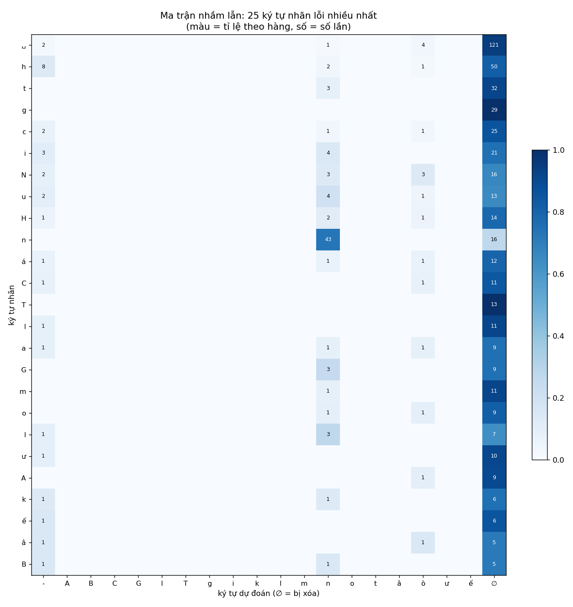

Cặp ký tự (nhãn -> dự đoán; ∅ = bị xóa hoặc thừa):

| Cặp | Số lần | % tổng lỗi | % lần xuất hiện của ký tự nhãn |
|---|---|---|---|
| `␣` -> `∅` | 121 | 15.1 | 94.5 |
| `h` -> `∅` | 50 | 6.2 | 82.0 |
| `t` -> `∅` | 32 | 4.0 | 91.4 |
| `g` -> `∅` | 29 | 3.6 | 100.0 |
| `c` -> `∅` | 25 | 3.1 | 86.2 |
| `i` -> `∅` | 21 | 2.6 | 75.0 |
| `n` -> `∅` | 16 | 2.0 | 27.1 |
| `N` -> `∅` | 16 | 2.0 | 66.7 |
| `H` -> `∅` | 14 | 1.7 | 77.8 |
| `u` -> `∅` | 13 | 1.6 | 65.0 |
| `T` -> `∅` | 13 | 1.6 | 100.0 |
| `á` -> `∅` | 12 | 1.5 | 80.0 |
| `l` -> `∅` | 11 | 1.4 | 91.7 |
| `C` -> `∅` | 11 | 1.4 | 84.6 |
| `m` -> `∅` | 11 | 1.4 | 91.7 |
| `ư` -> `∅` | 10 | 1.2 | 90.9 |
| `o` -> `∅` | 9 | 1.1 | 81.8 |
| `A` -> `∅` | 9 | 1.1 | 90.0 |
| `G` -> `∅` | 9 | 1.1 | 75.0 |
| `a` -> `∅` | 9 | 1.1 | 75.0 |

Cụm lỗi liền nhau (cho thấy cả các nhầm lẫn nhiều ký tự như m -> rn):

| Nhãn | Dự đoán | Số lần |
|---|---|---|
| `g` | `∅` | 10 |
| `h` | `∅` | 4 |
| `lợ lợ` | `-n` | 1 |
| `ti` | `-` | 1 |
| `Kiê` | `∅` | 1 |
| `thu` | `-` | 1 |
| `Ẻo hoẹ` | `-òn` | 1 |
| `bị gậy` | `-n` | 1 |
| `ĐIÊU` | `-òn` | 1 |
| `Chừa` | `-n` | 1 |
| `cơ thuỷ` | `-òn` | 1 |
| `xế tuổi` | `-òn` | 1 |

## 4. Nhóm lỗi "ký tự giống nhau"

Nhóm này chiếm 1 lỗi (0.1% tổng lỗi). Nhóm đang xét (sửa được ở `LOOKALIKE_GROUPS`): 0Oo, 1lI, 5Ss, 8B, 2Zz, 6G, 9gq, uv, il, mn, ec.

| Cặp | Số lần nhầm | Số lần ký tự nhãn xuất hiện |
|---|---|---|
| `O` -> `0` | 0 | 7 |
| `0` -> `O` | 0 | 0 |
| `o` -> `0` | 0 | 11 |
| `0` -> `o` | 0 | 0 |
| `l` -> `1` | 0 | 12 |
| `1` -> `l` | 0 | 0 |
| `l` -> `I` | 0 | 12 |
| `I` -> `l` | 0 | 11 |
| `I` -> `1` | 0 | 11 |
| `1` -> `I` | 0 | 0 |
| `S` -> `5` | 0 | 4 |
| `5` -> `S` | 0 | 0 |
| `s` -> `5` | 0 | 4 |
| `5` -> `s` | 0 | 0 |

| Cặp nhiều ký tự | Số lần |
|---|---|
| `cl` -> `d` | 0 |
| `d` -> `cl` | 0 |
| `h` -> `ln` | 0 |
| `ii` -> `u` | 0 |
| `ln` -> `h` | 0 |
| `m` -> `nn` | 0 |
| `m` -> `rn` | 0 |
| `nn` -> `m` | 0 |
| `rn` -> `m` | 0 |
| `u` -> `ii` | 0 |
| `vv` -> `w` | 0 |
| `w` -> `vv` | 0 |

## 5. Lỗi dấu tiếng Việt

Nhãn có 204 ký tự mang dấu (24.1% số ký tự). Phân loại bằng NFD:

|  | Sai loại | Thiếu | Thừa |
|---|---|---|---|
| Dấu thanh (sắc/huyền/hỏi/ngã/nặng) | 0 | 0 | 1 |
| Dấu phụ (mũ/móc/trăng/gạch đ) | 0 | 2 | 0 |

Sai cả hai loại dấu cùng lúc: 5; mất hẳn chữ có dấu: 146.

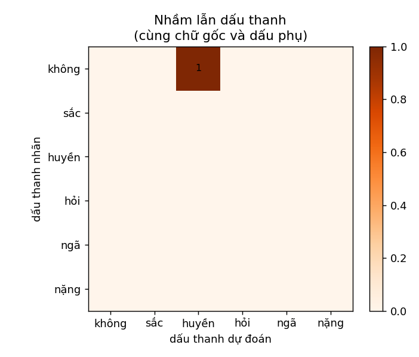

| Loại | Dấu phụ nhãn | Dấu phụ dự đoán | Số lần |
|---|---|---|---|
| Thiếu dấu phụ (â/ă/ê/ô/ơ/ư/đ -> chữ gốc) | mũ | ∅ | 2 |

### CER có dấu so với bỏ dấu

| Cách tính | CER (%) | Word Acc (%) | Giảm so với đầy đủ (điểm %) |
|---|---|---|---|
| đầy đủ | 94.92 | 0.00 | 0.00 |
| bỏ dấu | 92.67 | 0.00 | 2.25 |
| bỏ hoa/thường | 93.26 | 0.00 | 1.65 |
| bỏ dấu + hoa/thường | 90.31 | 0.00 | 4.61 |

Bỏ dấu khỏi cả nhãn lẫn dự đoán làm CER giảm 2.25 điểm (2.4% của CER), Word Acc tăng 0.00 điểm. Đây là **ước lượng** phần lỗi do dấu: bỏ dấu cũng làm thay đổi các lỗi khác (vd. đ -> d), nên con số không tách bạch tuyệt đối.

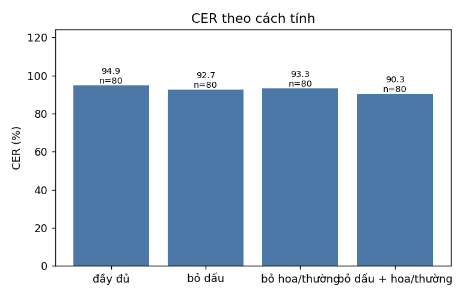

## 6. Lỗi theo đặc trưng của mẫu

Mỗi bảng ghi rõ số mẫu `n`; nhóm nhỏ (n < 30) có độ nhiễu cao.

### Theo độ dài nhãn (số ký tự)

| Nhóm | n | CER (%) | Word Acc (%) |
|---|---|---|---|
| 1-5 | 6 | 88.00 | 0.00 |
| 6-10 | 44 | 94.92 | 0.00 |
| 11-15 | 16 | 94.86 | 0.00 |
| 16-20 | 12 | 95.67 | 0.00 |
| 21+ | 2 | 95.56 | 0.00 |

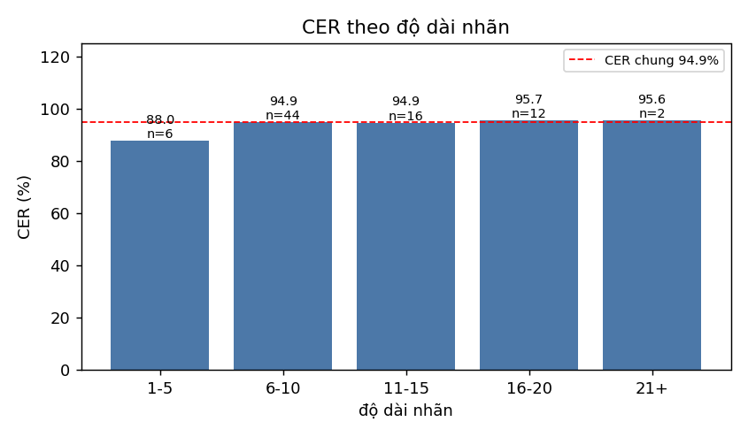

### Theo kiểu chữ

| Nhóm | n | CER (%) | Word Acc (%) |
|---|---|---|---|
| CHỮ HOA | 18 | 100.00 | 0.00 |
| Hoa đầu câu/hỗn hợp | 14 | 93.98 | 0.00 |
| chữ thường | 36 | 93.58 | 0.00 |
| Viết Hoa Từng Từ | 12 | 92.48 | 0.00 |

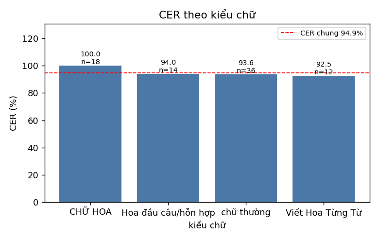

### Theo T/(L+R) (T = rộng@H=32 chia 4; càng thấp càng sát giới hạn CTC)

| Nhóm | n | CER (%) | Word Acc (%) |
|---|---|---|---|
| 1.5-2 | 12 | 93.10 | 0.00 |
| 2-3 | 60 | 94.88 | 0.00 |
| >=3 | 8 | 100.00 | 0.00 |

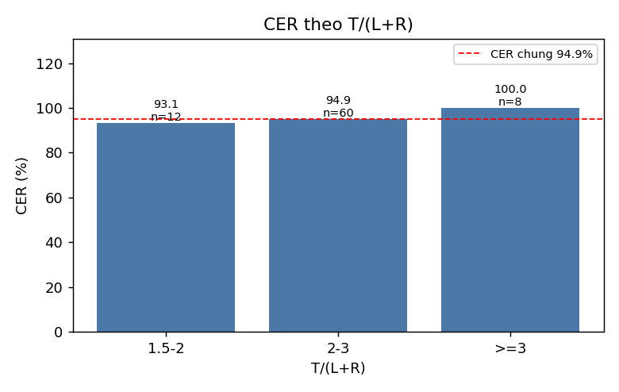

### Theo độ tương phản ảnh (độ lệch chuẩn điểm ảnh)

| Nhóm | n | CER (%) | Word Acc (%) |
|---|---|---|---|
| Q1 (tương phản thấp nhất) | 20 | 94.30 | 0.00 |
| Q2 | 20 | 94.32 | 0.00 |
| Q3 | 20 | 95.59 | 0.00 |
| Q4 (cao nhất) | 20 | 95.68 | 0.00 |

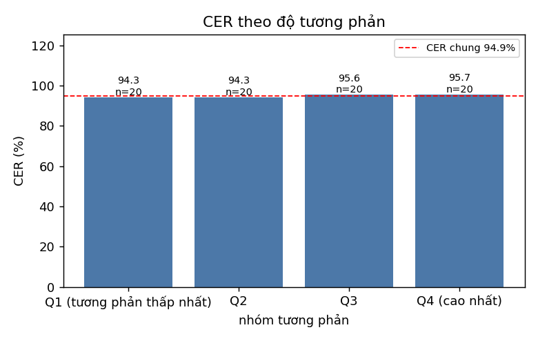

## 7. Ví dụ dự đoán

Dự đoán đúng được chọn ngẫu nhiên có seed; dự đoán sai được chọn lần lượt từ loại lỗi phổ biến nhất, ưu tiên mẫu ít lỗi cho dễ đọc (không chọn theo cảm tính). Cột nguyên nhân là **giả thuyết** suy từ loại lỗi và các đặc trưng đo được của ảnh, chưa kiểm chứng bằng thí nghiệm.

### 10 dự đoán sai

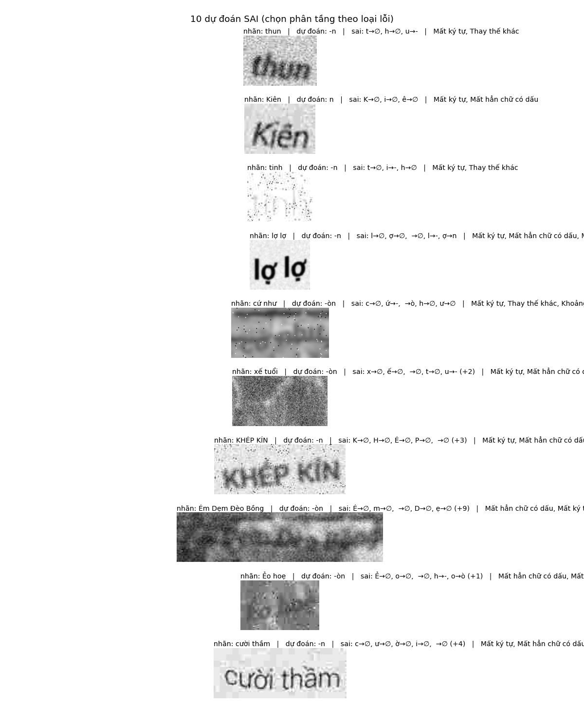

| # | Ảnh | Nhãn | Dự đoán | Chỗ sai | Loại lỗi | Nhận xét nguyên nhân |
|---|---|---|---|---|---|---|
| 1 | 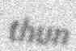 | `thun` | `-n` | `t→∅, h→∅, u→-` | Mất ký tự, Thay thế khác | mất ký tự: ký tự bị bỏ sót: T hẹp so với nhãn, nét mờ hoặc mô hình chưa hội tụ; thay thế khác: nhầm hai ký tự không thuộc nhóm nào ở trên |
| 2 | 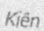 | `Kiên` | `n` | `K→∅, i→∅, ê→∅` | Mất ký tự, Mất hẳn chữ có dấu | mất ký tự: ký tự bị bỏ sót: T hẹp so với nhãn, nét mờ hoặc mô hình chưa hội tụ; mất hẳn chữ có dấu: chữ có dấu bị bỏ hẳn, thường do T hẹp, ảnh mờ hoặc mô hình thiên về blank |
| 3 | 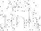 | `tinh` | `-n` | `t→∅, i→-, h→∅` | Mất ký tự, Thay thế khác | mất ký tự: ký tự bị bỏ sót: T hẹp so với nhãn, nét mờ hoặc mô hình chưa hội tụ; thay thế khác: nhầm hai ký tự không thuộc nhóm nào ở trên |
| 4 | 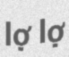 | `lợ lợ` | `-n` | `l→∅, ợ→∅,  →∅, l→-, ợ→n` | Mất ký tự, Mất hẳn chữ có dấu, Mất khoảng trắng, Thay thế khác | thay thế khác: nhầm hai ký tự không thuộc nhóm nào ở trên; mất ký tự: ký tự bị bỏ sót: T hẹp so với nhãn, nét mờ hoặc mô hình chưa hội tụ; mất hẳn chữ có dấu: chữ có dấu bị bỏ hẳn, thường do T hẹp, ảnh mờ hoặc mô hình thiên về blank |
| 5 | 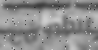 | `cứ như` | `-òn` | `c→∅, ứ→-,  →ò, h→∅, ư→∅` | Mất ký tự, Thay thế khác, Khoảng trắng bị thay, Mất hẳn chữ có dấu | mất ký tự: ký tự bị bỏ sót: T hẹp so với nhãn, nét mờ hoặc mô hình chưa hội tụ; thay thế khác: nhầm hai ký tự không thuộc nhóm nào ở trên; khoảng trắng bị thay: khoảng trắng hẹp hoặc rộng tùy font nên ranh giới từ khó xác định |
| 6 | 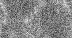 | `xế tuổi` | `-òn` | `x→∅, ế→∅,  →∅, t→∅, u→- (+2)` | Mất ký tự, Mất hẳn chữ có dấu, Mất khoảng trắng, Thay thế khác, Sai cả dấu phụ lẫn dấu thanh | mất ký tự: ký tự bị bỏ sót: T hẹp so với nhãn, nét mờ hoặc mô hình chưa hội tụ; thay thế khác: nhầm hai ký tự không thuộc nhóm nào ở trên; mất hẳn chữ có dấu: chữ có dấu bị bỏ hẳn, thường do T hẹp, ảnh mờ hoặc mô hình thiên về blank |
| 7 | 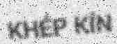 | `KHÉP KÍN` | `-n` | `K→∅, H→∅, É→∅, P→∅,  →∅ (+3)` | Mất ký tự, Mất hẳn chữ có dấu, Mất khoảng trắng, Thay thế khác, Sai hoa/thường (c/C, o/O...) | mất ký tự: ký tự bị bỏ sót: T hẹp so với nhãn, nét mờ hoặc mô hình chưa hội tụ; mất hẳn chữ có dấu: chữ có dấu bị bỏ hẳn, thường do T hẹp, ảnh mờ hoặc mô hình thiên về blank; mất khoảng trắng: khoảng trắng hẹp bị bỏ qua |
| 8 | 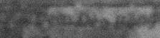 | `Ém Dẹm Đèo Bồng` | `-òn` | `É→∅, m→∅,  →∅, D→∅, ẹ→∅ (+9)` | Mất hẳn chữ có dấu, Mất ký tự, Mất khoảng trắng, Thay thế khác, Thiếu dấu phụ (â/ă/ê/ô/ơ/ư/đ -> chữ gốc) | mất ký tự: ký tự bị bỏ sót: T hẹp so với nhãn, nét mờ hoặc mô hình chưa hội tụ; mất hẳn chữ có dấu: chữ có dấu bị bỏ hẳn, thường do T hẹp, ảnh mờ hoặc mô hình thiên về blank; mất khoảng trắng: khoảng trắng hẹp bị bỏ qua | bối cảnh đo được: ảnh thuộc nhóm tương phản thấp nhất 25% |
| 9 | 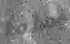 | `Ẻo hoẹ` | `-òn` | `Ẻ→∅, o→∅,  →∅, h→-, o→ò (+1)` | Mất hẳn chữ có dấu, Mất ký tự, Mất khoảng trắng, Thay thế khác, Thừa dấu thanh | thay thế khác: nhầm hai ký tự không thuộc nhóm nào ở trên; mất hẳn chữ có dấu: chữ có dấu bị bỏ hẳn, thường do T hẹp, ảnh mờ hoặc mô hình thiên về blank; mất ký tự: ký tự bị bỏ sót: T hẹp so với nhãn, nét mờ hoặc mô hình chưa hội tụ | bối cảnh đo được: ảnh thuộc nhóm tương phản thấp nhất 25% |
| 10 | 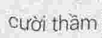 | `cười thầm` | `-n` | `c→∅, ư→∅, ờ→∅, i→∅,  →∅ (+4)` | Mất ký tự, Mất hẳn chữ có dấu, Mất khoảng trắng, Thay thế khác, Ký tự giống nhau (O/0, l/1/I, S/5...) | mất ký tự: ký tự bị bỏ sót: T hẹp so với nhãn, nét mờ hoặc mô hình chưa hội tụ; mất hẳn chữ có dấu: chữ có dấu bị bỏ hẳn, thường do T hẹp, ảnh mờ hoặc mô hình thiên về blank; mất khoảng trắng: khoảng trắng hẹp bị bỏ qua |

(Không có dự đoán nào khớp hoàn toàn nên không có ví dụ đúng.)

## 8. Đề xuất cải thiện (rút ra từ số liệu ở trên)

Mỗi đề xuất kèm con số quan sát được. Đây là tương quan từ một lần đánh giá, chưa phải bằng chứng nhân quả: cách kiểm chứng là thay đổi đúng một yếu tố và chạy lại `eval.py` + phân tích này.

1. **Ưu tiên 1: mô hình có thể chưa hội tụ.** CER = 94.9% và Word Acc = 0.0% (khoảng tin cậy CER 95%: 93.8-96.1%). Val CER của run là 94.3%, cùng mức với tập này. Việc cần làm trước: huấn luyện thêm (xem `val_cer` còn giảm không) rồi chạy lại phân tích; tỉ lệ các loại lỗi bên dưới chỉ mang tính chỉ hướng.
2. **Mất ký tự chiếm 67.0% số lỗi** (D = 659 so với S = 144, I = 0). Thử `configs/model_s2.yaml` (stride 2) hoặc `model_h48.yaml` và so sánh số lỗi D trước/sau.
3. **Lỗi khoảng trắng chiếm 15.9% số lỗi.** Xem xét đánh giá thêm theo từ, hoặc tăng tỉ lệ dòng nhiều từ trong dữ liệu.

## 9. Phương pháp và giới hạn

- Căn chỉnh bằng Levenshtein DP (khớp/thay > xóa > chèn khi hòa); căn chỉnh tối thiểu không duy nhất nên cặp nhầm lẫn phụ thuộc quy tắc hòa.
- Mỗi thao tác lỗi thuộc đúng một loại; cụm lỗi khớp m<->rn, cl<->d... được gán 'cặp giống nhau' cho toàn cụm.
- Chữ gốc và dấu tách bằng `unicodedata` NFD; 'đ' xử lý riêng (gạch ngang). Khi cả dấu phụ và dấu thanh cùng sai thì xếp vào loại 'sai cả hai'.
- Họ font suy ra từ tên file; T/(L+R) tính với `--img_height` và `--stride` đã khai báo (mặc định 32 và 4).
