# Phân tích lỗi: vi_finetune / vi_test_greedy

> **Cảnh báo độ tin cậy:** CER = 95.6% rất cao, cùng mức với val CER (94.3%) nên mô hình có thể chưa hội tụ; phần phân loại lỗi mang tính chỉ hướng.

## 1. Tổng quan

| Chỉ số | Giá trị |
|---|---|
| Số mẫu / số ký tự nhãn | 80 / 796 |
| CER | 95.60% (95% CI: 94.47-96.74%) |
| Word Accuracy (khớp hoàn toàn) | 0.00% (95% CI: 0.00-0.00%) |
| Thay thế S / Xóa D / Chèn I | 131 / 630 / 0  (16.46% / 79.15% / 0.00% số ký tự nhãn) |

Khoảng tin cậy bootstrap theo mẫu (1000 lần). CER = (S+D+I)/N gộp toàn tập.

## 2. Phân bố lỗi theo loại

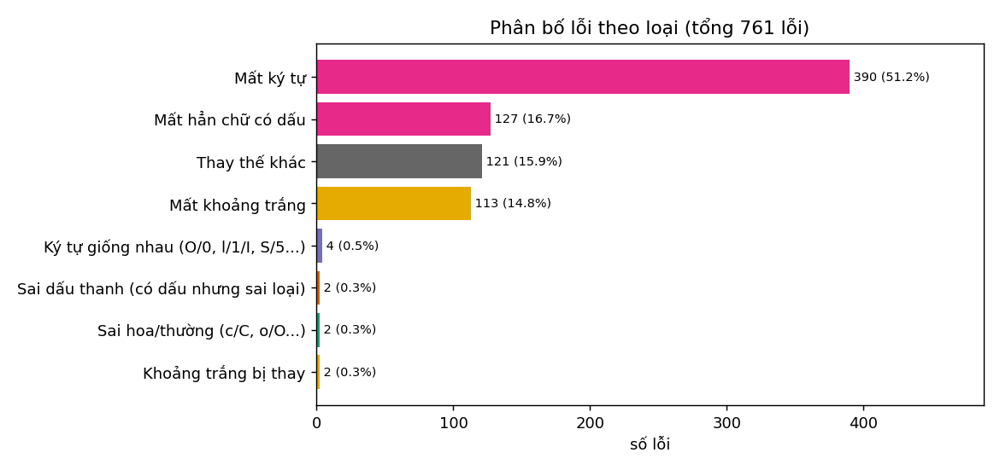

| Loại lỗi | Nhóm | Số lỗi | % tổng lỗi |
|---|---|---|---|
| Mất ký tự | Mất ký tự | 390 | 51.2 |
| Mất hẳn chữ có dấu | Mất ký tự | 127 | 16.7 |
| Thay thế khác | Thay thế khác | 121 | 15.9 |
| Mất khoảng trắng | Khoảng trắng | 113 | 14.8 |
| Ký tự giống nhau (O/0, l/1/I, S/5...) | Ký tự giống nhau | 4 | 0.5 |
| Khoảng trắng bị thay | Khoảng trắng | 2 | 0.3 |
| Sai hoa/thường (c/C, o/O...) | Hoa/thường | 2 | 0.3 |
| Sai dấu thanh (có dấu nhưng sai loại) | Lỗi dấu tiếng Việt | 2 | 0.3 |

Theo nhóm lớn: Mất ký tự 517 (67.9%); Thay thế khác 121 (15.9%); Khoảng trắng 115 (15.1%); Ký tự giống nhau 4 (0.5%); Hoa/thường 2 (0.3%); Lỗi dấu tiếng Việt 2 (0.3%)

## 3. Ma trận nhầm lẫn và top-20 cặp nhầm lẫn

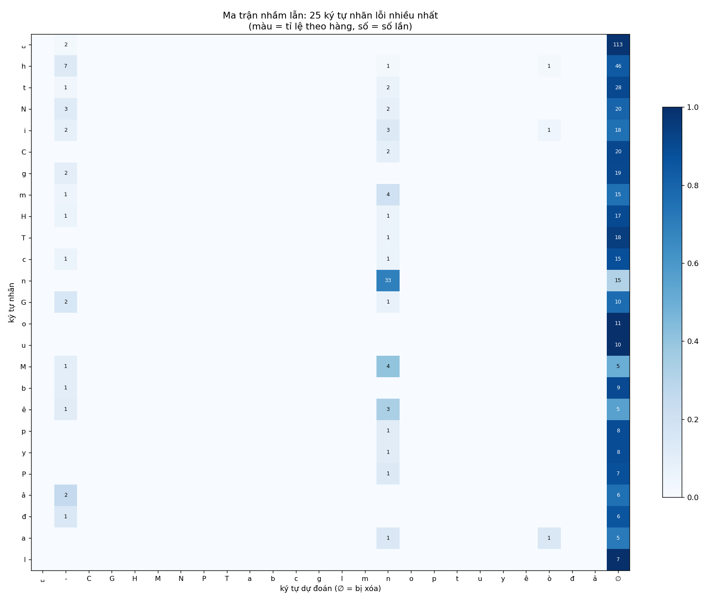

Cặp ký tự (nhãn -> dự đoán; ∅ = bị xóa hoặc thừa):

| Cặp | Số lần | % tổng lỗi | % lần xuất hiện của ký tự nhãn |
|---|---|---|---|
| `␣` -> `∅` | 113 | 14.8 | 98.3 |
| `h` -> `∅` | 46 | 6.0 | 83.6 |
| `t` -> `∅` | 28 | 3.7 | 90.3 |
| `C` -> `∅` | 20 | 2.6 | 90.9 |
| `N` -> `∅` | 20 | 2.6 | 80.0 |
| `g` -> `∅` | 19 | 2.5 | 90.5 |
| `i` -> `∅` | 18 | 2.4 | 75.0 |
| `T` -> `∅` | 18 | 2.4 | 94.7 |
| `H` -> `∅` | 17 | 2.2 | 89.5 |
| `n` -> `∅` | 15 | 2.0 | 31.2 |
| `c` -> `∅` | 15 | 2.0 | 88.2 |
| `m` -> `∅` | 15 | 2.0 | 75.0 |
| `o` -> `∅` | 11 | 1.4 | 100.0 |
| `u` -> `∅` | 10 | 1.3 | 100.0 |
| `G` -> `∅` | 10 | 1.3 | 76.9 |
| `b` -> `∅` | 9 | 1.2 | 90.0 |
| `p` -> `∅` | 8 | 1.1 | 88.9 |
| `y` -> `∅` | 8 | 1.1 | 88.9 |
| `h` -> `-` | 7 | 0.9 | 12.7 |
| `P` -> `∅` | 7 | 0.9 | 87.5 |

Cụm lỗi liền nhau (cho thấy cả các nhầm lẫn nhiều ký tự như m -> rn):

| Nhãn | Dự đoán | Số lần |
|---|---|---|
| `h` | `∅` | 5 |
| `g` | `∅` | 5 |
| `hê` | `-n` | 1 |
| `đọa` | `-n` | 1 |
| `nghê` | `-òn` | 1 |
| `ục ịch` | `-n` | 1 |
| `Puli` | `n` | 1 |
| `lộ phí` | `-n` | 1 |
| `riđô` | `-n` | 1 |
| `Gợi Ý` | `-n` | 1 |
| `khó ở` | `n` | 1 |
| `CHIM` | `n` | 1 |

## 4. Nhóm lỗi "ký tự giống nhau"

Nhóm này chiếm 4 lỗi (0.5% tổng lỗi). Nhóm đang xét (sửa được ở `LOOKALIKE_GROUPS`): 0Oo, 1lI, 5Ss, 8B, 2Zz, 6G, 9gq, uv, il, mn, ec.

| Cặp | Số lần nhầm | Số lần ký tự nhãn xuất hiện |
|---|---|---|
| `O` -> `0` | 0 | 5 |
| `0` -> `O` | 0 | 2 |
| `o` -> `0` | 0 | 11 |
| `0` -> `o` | 0 | 2 |
| `l` -> `1` | 0 | 7 |
| `1` -> `l` | 0 | 3 |
| `l` -> `I` | 0 | 7 |
| `I` -> `l` | 0 | 5 |
| `I` -> `1` | 0 | 5 |
| `1` -> `I` | 0 | 3 |
| `S` -> `5` | 0 | 3 |
| `5` -> `S` | 0 | 1 |
| `s` -> `5` | 0 | 2 |
| `5` -> `s` | 0 | 1 |

| Cặp nhiều ký tự | Số lần |
|---|---|
| `cl` -> `d` | 0 |
| `d` -> `cl` | 0 |
| `h` -> `ln` | 0 |
| `ii` -> `u` | 0 |
| `ln` -> `h` | 0 |
| `m` -> `nn` | 0 |
| `m` -> `rn` | 0 |
| `nn` -> `m` | 0 |
| `rn` -> `m` | 0 |
| `u` -> `ii` | 0 |
| `vv` -> `w` | 0 |
| `w` -> `vv` | 0 |

## 5. Lỗi dấu tiếng Việt

Nhãn có 187 ký tự mang dấu (23.5% số ký tự). Phân loại bằng NFD:

|  | Sai loại | Thiếu | Thừa |
|---|---|---|---|
| Dấu thanh (sắc/huyền/hỏi/ngã/nặng) | 2 | 0 | 0 |
| Dấu phụ (mũ/móc/trăng/gạch đ) | 0 | 0 | 0 |

Sai cả hai loại dấu cùng lúc: 0; mất hẳn chữ có dấu: 127.

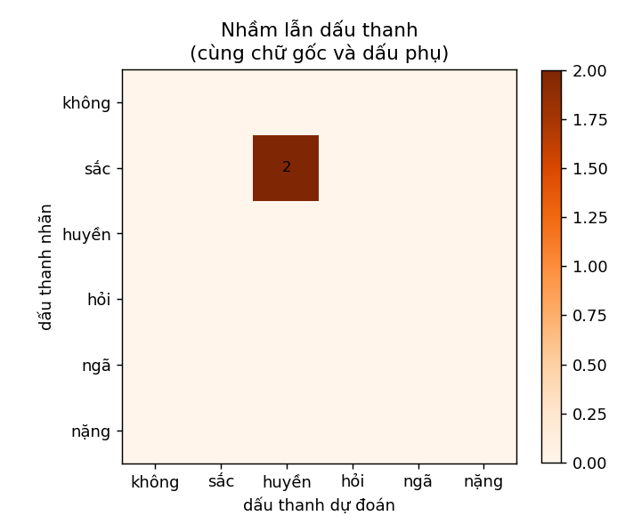

### CER có dấu so với bỏ dấu

| Cách tính | CER (%) | Word Acc (%) | Giảm so với đầy đủ (điểm %) |
|---|---|---|---|
| đầy đủ | 95.60 | 0.00 | 0.00 |
| bỏ dấu | 95.10 | 0.00 | 0.50 |
| bỏ hoa/thường | 94.10 | 0.00 | 1.51 |
| bỏ dấu + hoa/thường | 93.34 | 0.00 | 2.26 |

Bỏ dấu khỏi cả nhãn lẫn dự đoán làm CER giảm 0.50 điểm (0.5% của CER), Word Acc tăng 0.00 điểm. Đây là **ước lượng** phần lỗi do dấu: bỏ dấu cũng làm thay đổi các lỗi khác (vd. đ -> d), nên con số không tách bạch tuyệt đối.

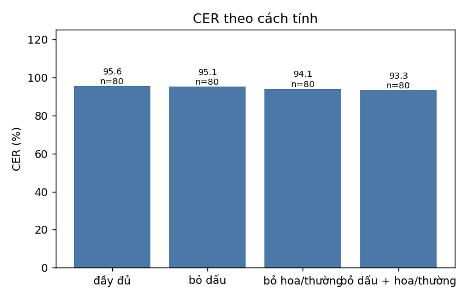

## 6. Lỗi theo đặc trưng của mẫu

Mỗi bảng ghi rõ số mẫu `n`; nhóm nhỏ (n < 30) có độ nhiễu cao.

### Theo độ dài nhãn (số ký tự)

| Nhóm | n | CER (%) | Word Acc (%) |
|---|---|---|---|
| 1-5 | 12 | 97.92 | 0.00 |
| 6-10 | 41 | 94.03 | 0.00 |
| 11-15 | 11 | 95.86 | 0.00 |
| 16-20 | 14 | 96.68 | 0.00 |
| 21+ | 2 | 97.73 | 0.00 |

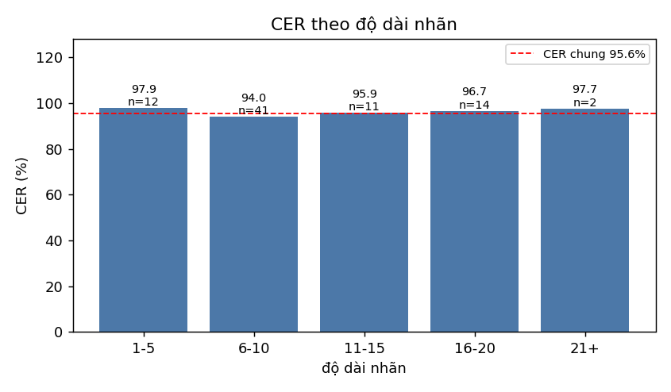

### Theo kiểu chữ

| Nhóm | n | CER (%) | Word Acc (%) |
|---|---|---|---|
| CHỮ HOA | 18 | 100.00 | 0.00 |
| Viết Hoa Từng Từ | 13 | 94.33 | 0.00 |
| có chữ số/mã | 5 | 94.29 | 0.00 |
| chữ thường | 33 | 94.28 | 0.00 |
| Hoa đầu câu/hỗn hợp | 11 | 93.94 | 0.00 |

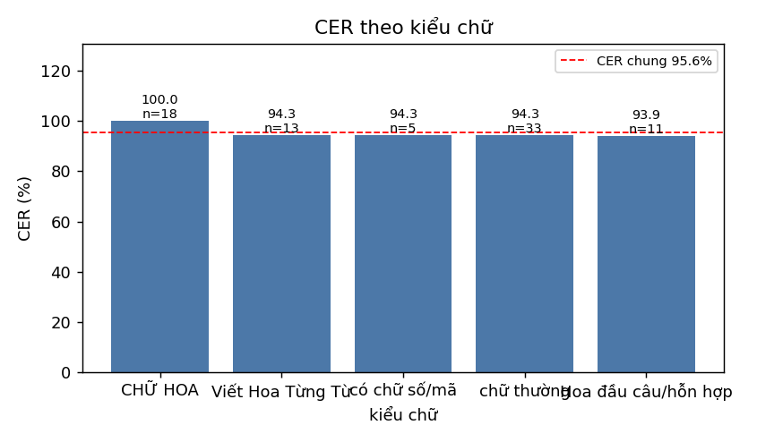

### Theo T/(L+R) (T = rộng@H=32 chia 4; càng thấp càng sát giới hạn CTC)

| Nhóm | n | CER (%) | Word Acc (%) |
|---|---|---|---|
| 1.5-2 | 2 | 95.65 | 0.00 |
| 2-3 | 51 | 95.42 | 0.00 |
| >=3 | 27 | 96.17 | 0.00 |

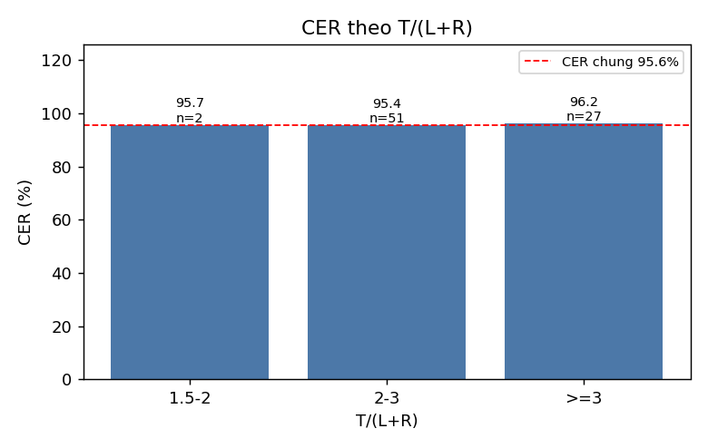

### Theo độ tương phản ảnh (độ lệch chuẩn điểm ảnh)

| Nhóm | n | CER (%) | Word Acc (%) |
|---|---|---|---|
| Q1 (tương phản thấp nhất) | 20 | 95.11 | 0.00 |
| Q2 | 20 | 96.60 | 0.00 |
| Q3 | 20 | 95.58 | 0.00 |
| Q4 (cao nhất) | 20 | 95.11 | 0.00 |

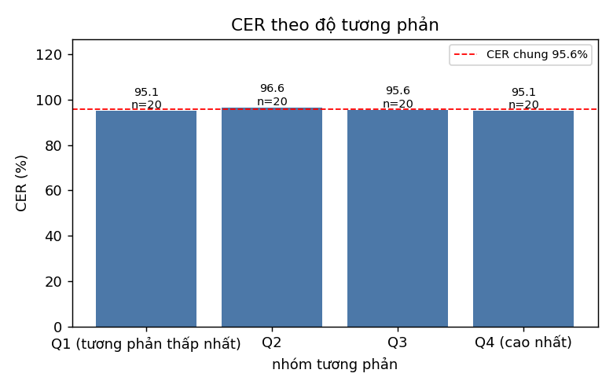

## 7. Ví dụ dự đoán

Dự đoán đúng được chọn ngẫu nhiên có seed; dự đoán sai được chọn lần lượt từ loại lỗi phổ biến nhất, ưu tiên mẫu ít lỗi cho dễ đọc (không chọn theo cảm tính). Cột nguyên nhân là **giả thuyết** suy từ loại lỗi và các đặc trưng đo được của ảnh, chưa kiểm chứng bằng thí nghiệm.

### 10 dự đoán sai

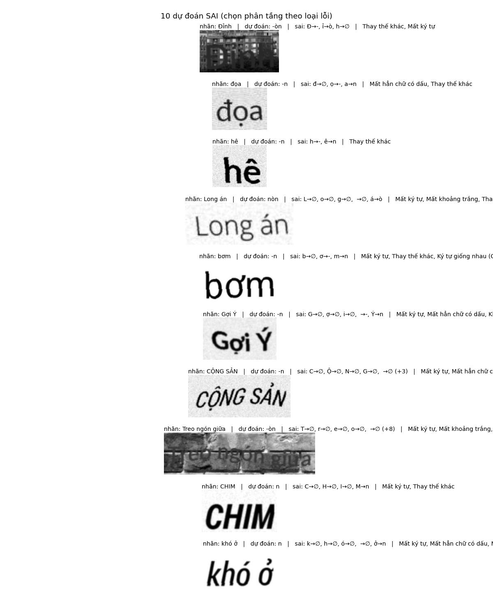

| # | Ảnh | Nhãn | Dự đoán | Chỗ sai | Loại lỗi | Nhận xét nguyên nhân |
|---|---|---|---|---|---|---|
| 1 |  | `Đỉnh` | `-òn` | `Đ→-, ỉ→ò, h→∅` | Thay thế khác, Mất ký tự | thay thế khác: nhầm hai ký tự không thuộc nhóm nào ở trên; mất ký tự: ký tự bị bỏ sót: T hẹp so với nhãn, nét mờ hoặc mô hình chưa hội tụ | bối cảnh đo được: ảnh thuộc nhóm tương phản thấp nhất 25% |
| 2 | 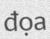 | `đọa` | `-n` | `đ→∅, ọ→-, a→n` | Mất hẳn chữ có dấu, Thay thế khác | thay thế khác: nhầm hai ký tự không thuộc nhóm nào ở trên; mất hẳn chữ có dấu: chữ có dấu bị bỏ hẳn, thường do T hẹp, ảnh mờ hoặc mô hình thiên về blank | bối cảnh đo được: ảnh thuộc nhóm tương phản thấp nhất 25% |
| 3 | 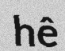 | `hê` | `-n` | `h→-, ê→n` | Thay thế khác | thay thế khác: nhầm hai ký tự không thuộc nhóm nào ở trên |
| 4 | 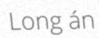 | `Long án` | `nòn` | `L→∅, o→∅, g→∅,  →∅, á→ò` | Mất ký tự, Mất khoảng trắng, Thay thế khác | mất ký tự: ký tự bị bỏ sót: T hẹp so với nhãn, nét mờ hoặc mô hình chưa hội tụ; mất khoảng trắng: khoảng trắng hẹp bị bỏ qua; thay thế khác: nhầm hai ký tự không thuộc nhóm nào ở trên | bối cảnh đo được: ảnh thuộc nhóm tương phản thấp nhất 25% |
| 5 | 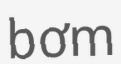 | `bơm` | `-n` | `b→∅, ơ→-, m→n` | Mất ký tự, Thay thế khác, Ký tự giống nhau (O/0, l/1/I, S/5...) | mất ký tự: ký tự bị bỏ sót: T hẹp so với nhãn, nét mờ hoặc mô hình chưa hội tụ; thay thế khác: nhầm hai ký tự không thuộc nhóm nào ở trên; ký tự giống nhau (o/0, l/1/i, s/5...): hai ký tự có hình dạng gần giống nhau, cần ngữ cảnh để phân biệt |
| 6 | 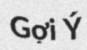 | `Gợi Ý` | `-n` | `G→∅, ợ→∅, i→∅,  →-, Ý→n` | Mất ký tự, Mất hẳn chữ có dấu, Khoảng trắng bị thay, Thay thế khác | mất ký tự: ký tự bị bỏ sót: T hẹp so với nhãn, nét mờ hoặc mô hình chưa hội tụ; mất hẳn chữ có dấu: chữ có dấu bị bỏ hẳn, thường do T hẹp, ảnh mờ hoặc mô hình thiên về blank; khoảng trắng bị thay: khoảng trắng hẹp hoặc rộng tùy font nên ranh giới từ khó xác định |
| 7 | 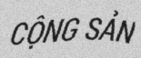 | `CỘNG SẢN` | `-n` | `C→∅, Ộ→∅, N→∅, G→∅,  →∅ (+3)` | Mất ký tự, Mất hẳn chữ có dấu, Mất khoảng trắng, Thay thế khác, Sai hoa/thường (c/C, o/O...) | mất ký tự: ký tự bị bỏ sót: T hẹp so với nhãn, nét mờ hoặc mô hình chưa hội tụ; mất hẳn chữ có dấu: chữ có dấu bị bỏ hẳn, thường do T hẹp, ảnh mờ hoặc mô hình thiên về blank; mất khoảng trắng: khoảng trắng hẹp bị bỏ qua |
| 8 | 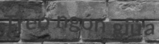 | `Treo ngón giữa` | `-òn` | `T→∅, r→∅, e→∅, o→∅,  →∅ (+8)` | Mất ký tự, Mất khoảng trắng, Thay thế khác, Sai dấu thanh (có dấu nhưng sai loại), Mất hẳn chữ có dấu | mất ký tự: ký tự bị bỏ sót: T hẹp so với nhãn, nét mờ hoặc mô hình chưa hội tụ; mất khoảng trắng: khoảng trắng hẹp bị bỏ qua; thay thế khác: nhầm hai ký tự không thuộc nhóm nào ở trên | bối cảnh đo được: ảnh thuộc nhóm tương phản thấp nhất 25% |
| 9 | 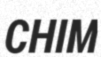 | `CHIM` | `n` | `C→∅, H→∅, I→∅, M→n` | Mất ký tự, Thay thế khác | mất ký tự: ký tự bị bỏ sót: T hẹp so với nhãn, nét mờ hoặc mô hình chưa hội tụ; thay thế khác: nhầm hai ký tự không thuộc nhóm nào ở trên |
| 10 | 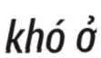 | `khó ở` | `n` | `k→∅, h→∅, ó→∅,  →∅, ở→n` | Mất ký tự, Mất hẳn chữ có dấu, Mất khoảng trắng, Thay thế khác | mất ký tự: ký tự bị bỏ sót: T hẹp so với nhãn, nét mờ hoặc mô hình chưa hội tụ; mất hẳn chữ có dấu: chữ có dấu bị bỏ hẳn, thường do T hẹp, ảnh mờ hoặc mô hình thiên về blank; mất khoảng trắng: khoảng trắng hẹp bị bỏ qua |

(Không có dự đoán nào khớp hoàn toàn nên không có ví dụ đúng.)

## 8. Đề xuất cải thiện (rút ra từ số liệu ở trên)

Mỗi đề xuất kèm con số quan sát được. Đây là tương quan từ một lần đánh giá, chưa phải bằng chứng nhân quả: cách kiểm chứng là thay đổi đúng một yếu tố và chạy lại `eval.py` + phân tích này.

1. **Ưu tiên 1: mô hình có thể chưa hội tụ.** CER = 95.6% và Word Acc = 0.0% (khoảng tin cậy CER 95%: 94.5-96.7%). Val CER của run là 94.3%, cùng mức với tập này. Việc cần làm trước: huấn luyện thêm (xem `val_cer` còn giảm không) rồi chạy lại phân tích; tỉ lệ các loại lỗi bên dưới chỉ mang tính chỉ hướng.
2. **Mất ký tự chiếm 67.9% số lỗi** (D = 630 so với S = 131, I = 0). Thử `configs/model_s2.yaml` (stride 2) hoặc `model_h48.yaml` và so sánh số lỗi D trước/sau.
3. **Lỗi khoảng trắng chiếm 15.1% số lỗi.** Xem xét đánh giá thêm theo từ, hoặc tăng tỉ lệ dòng nhiều từ trong dữ liệu.

## 9. Phương pháp và giới hạn

- Căn chỉnh bằng Levenshtein DP (khớp/thay > xóa > chèn khi hòa); căn chỉnh tối thiểu không duy nhất nên cặp nhầm lẫn phụ thuộc quy tắc hòa.
- Mỗi thao tác lỗi thuộc đúng một loại; cụm lỗi khớp m<->rn, cl<->d... được gán 'cặp giống nhau' cho toàn cụm.
- Chữ gốc và dấu tách bằng `unicodedata` NFD; 'đ' xử lý riêng (gạch ngang). Khi cả dấu phụ và dấu thanh cùng sai thì xếp vào loại 'sai cả hai'.
- Họ font suy ra từ tên file; T/(L+R) tính với `--img_height` và `--stride` đã khai báo (mặc định 32 và 4).
